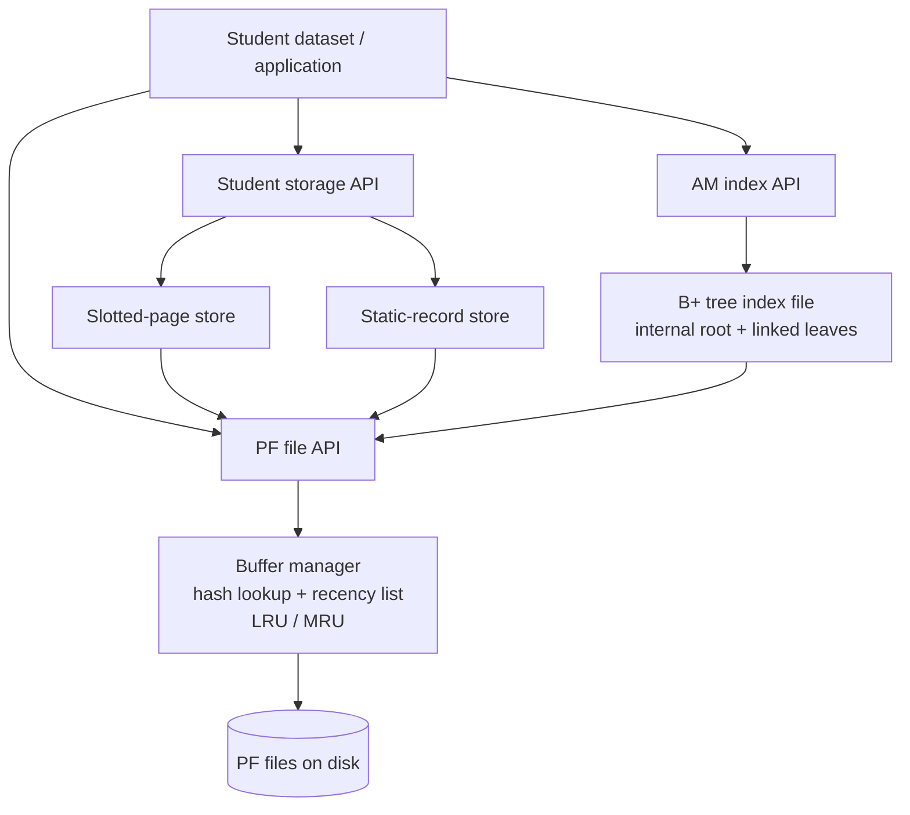

# ToyDB DBMS Project

A layered database-storage project implemented in C. The repository brings together a **Paged File (PF) layer and configurable buffer manager**, two persistent Student-record storage formats (**slotted pages** and **static records**), and an **Access Method (AM) layer for Student B+ tree indexing**.

The implementation and experiments use 4,096-byte data pages and the supplied Student relation at `data/student.txt` (17,813 records in the validation dataset). Python 3 scripts automate the PF, AM, and storage experiments and generate CSV results, graphs, Excel workbooks, and analysis notes.

> **Start here:** this file is the repository front page. For the full architectural explanation, design rationale, validation evidence, measured results, and limitations, read the [master technical report](toydb/Technical_Report.md) or its [PDF version](toydb/Technical_Report.pdf).

---

## Project at a glance

The project is organized as three cooperating subsystems:

1. **PF layer:** manages PF files and pages, and provides a configurable in-memory buffer pool with LRU/MRU replacement, fixed-page protection, dirty-page writeback, and I/O statistics.
2. **Student storage:** stores variable-length Student records in slotted pages or fixed-size slots in static pages. Both formats are PF-backed and support RID-based retrieval and sequential scans.
3. **AM layer:** builds and searches Student roll-number indexes using one-shot insertion, incremental insertion, and sorted bulk loading. The current bulk-loaded structure has linked leaves and a single internal root.



The Student data file and AM index file are separate PF files. The AM leaf entries store roll-number keys and the RIDs of Student records; the RID is a physical page/slot locator, not the roll-number key.

---

## Repository guide

The main implementation and documentation live under `toydb/`:

```text
DBMS_Project/
├── README.md                         # This repository front page
├── Makefile                          # Unified build, test, and clean targets
├── data/
│   └── student.txt                   # Supplied Student dataset
└── toydb/
    ├── Technical_Report.md           # Master technical report (source)
    ├── Technical_Report.pdf          # Master technical report (PDF)
    ├── pflayer/
    │   ├── README.md                 # PF and buffer-manager architecture
    │   └── ...                       # PF file, buffer, hash, and test sources
    ├── amlayer/
    │   ├── README.md                 # AM/B+ tree architecture and decisions
    │   ├── AM_BENCHMARK_README.md    # AM benchmark methodology and outputs
    │   └── ...                       # AM implementation and regression tests
    ├── slottedpage/
    │   ├── README.md                 # Slotted/static storage implementation
    │   └── ...                       # Page managers, PF stores, and tests
    └── experiments/
        └── storage/
            ├── requirements.txt
            ├── run_pf_experiments.py
            ├── run_am_experiments.py
            ├── generate_storage_comparison.py
            ├── pf_layer/             # PF CSVs, graphs, workbook, and notes
            ├── am_layer/             # AM CSVs, graphs, workbook, and notes
            └── slotted_page/         # Storage CSVs, graphs, test output, notes
```

### Documentation map

| Document | What it covers |
|---|---|
| [Master Technical Report](toydb/Technical_Report.md) | Integrated architecture, design rationale, implementation details, experiments, results, validation, and limitations |
| [Master Technical Report (PDF)](toydb/Technical_Report.pdf) | Shareable PDF version of the complete report |
| [PF Layer README](toydb/pflayer/README.md) | PF file representation, buffer frames, hash lookup, LRU/MRU replacement, dirty pages, statistics, and PF tests |
| [AM Layer README](toydb/amlayer/README.md) | B+ tree page structures, key/RID organization, construction paths, duplicate-key handling, root capacity, and scan behaviour |
| [AM Benchmark README](toydb/amlayer/AM_BENCHMARK_README.md) | AM benchmark setup, measurement methodology, and benchmark outputs |
| [Slotted-Page / Static-Record README](toydb/slottedpage/README.md) | Page layouts, insert/retrieve/delete/compact operations, PF-backed stores, RID encoding, and storage comparison |

The detailed CSV files, graphs, Excel workbooks, and generated notes are kept beside the experiment runners in `toydb/experiments/storage/`. The master report links to the principal outputs.

---

## Main implementation features

### Paged File and buffer management

- PF file creation, destruction, open/close, page allocation, lookup, disposal, and unfix operations.
- A bounded buffer pool with a compile-time maximum of 20 frames and runtime-configurable capacity.
- LRU and MRU replacement policies.
- Fixed-page protection and dirty-page writeback on eviction/release.
- Statistics for logical reads/writes, physical reads/writes, and buffer hits.

### Slotted-page storage

- 4,096-byte pages with a 12-byte header and 4-byte slot descriptors.
- Variable-length record payloads packed from the end of the page.
- Tombstones, slot reuse, stable slot identifiers, and compaction.
- PF-backed persistence, RID retrieval, and callback-driven sequential scans.

### Static-record storage

- 4,096-byte pages with an 8-byte header.
- Fixed-size record slots with a 2-byte actual-length field.
- Tested maximum record lengths: 108, 112, 128, 160, and 256 bytes.
- PF-backed insertion, RID retrieval, scanning, and storage accounting.

### AM / Student B+ tree indexing

- One-shot, incremental, and sorted bulk-load construction paths.
- Eight-character Student roll-number keys mapped to Student RIDs.
- Linked leaf pages and RID lists for duplicate keys.
- Duplicate-key groups kept intact during bulk loading.
- Capacity-checked single internal root and dynamic leftmost-leaf discovery for `ALL` scans.
- G1-G4 regression coverage for duplicate grouping, a duplicate boundary, root capacity, and leftmost-leaf scanning.

---

## Selected experimental results

### Student storage comparison

The supplied dataset contains 17,813 Student records and 1,759,011 bytes of record payload (line endings excluded).

| Storage configuration | PF data pages | Payload utilization |
|---|---:|---:|
| Slotted pages | **454** | **94.59%** |
| Static records, `M=108` | 482 | 89.10% |
| Static records, `M=112` | 509 | 84.37% |
| Static records, `M=128` | 575 | 74.69% |
| Static records, `M=160` | 713 | 60.23% |
| Static records, `M=256` | 1,188 | 36.15% |

For this dataset, slotted pages use 28 fewer pages than the best tested static configuration (`M=108`) and improve payload utilization by 5.49 percentage points. This is a space-efficiency result; it does not establish that slotted pages are faster for every workload.

### PF buffer experiments

The PF experiment runner tests LRU and MRU with capacities of 2, 4, 8, and 16 frames using a fixed 12-reference sequence. Both policies reach five physical reads at capacities 8 and 16 for that sequence. A second workload uses a three-frame buffer, five pages, and 20 operations for each of five read/write mixes (100R/0W through 0R/100W). In that specific cyclic workload, MRU records fewer physical reads than LRU. These results are trace-specific and should not be interpreted as a universal ranking of replacement policies.

### AM index benchmarks

| Construction method | End-to-end build time | Median duplicate-key query time |
|---|---:|---:|
| One-shot | 0.070 s | 22 µs |
| Incremental | 0.070 s | 28 µs |
| Sorted bulk load | 0.050 s | 23 µs |

The build time includes Student record-storage preparation as well as index construction. Query measurements use 30 independent runs per method and a single duplicate roll-number key. The small timing differences should not be generalized beyond this benchmark setup.

For the supplied dataset, sorted bulk loading creates 71 leaf pages and 70 root separator keys. The current internal root can hold at most 340 separators / 341 child pointers.


## Using a different input data file

The underlying PF and page-storage code is **not limited to `student.txt`**. The slotted-page API stores arbitrary non-empty byte records with an explicit length, so another dataset can be loaded by writing a small input driver that reads each logical record and passes its bytes and length to `SPStore_Insert()`. At a high level, the driver calls `PF_Init()`, creates and opens an `SPStore`, reads records (handling the file's delimiters and any header), inserts each record with `SPStore_Insert()`, and closes the store; use RID retrieval or a sequential scan to verify the loaded data. A record must fit on an empty 4,096-byte slotted page (at most 4,080 bytes with the current 12-byte header and 4-byte slot descriptor). Static-record storage can also store other record contents, provided every record fits the selected maximum slot length `M`; choose `M` based on the longest record and the 4,096-byte page limit.

**The current experiment runners are still tailored to the supplied Student dataset:**

- `generate_storage_comparison.py` has a `--student-file` path option, but it validates the Student input profile: a header line, 16 semicolon-separated fields per record, 17,813 records, and 1,759,011 payload bytes. Supplying a different path works only when the file matches those expectations. For a genuinely different dataset, adapt the validation checks and the Student-specific C test driver, or write a separate loader/test driver for that file.
- `run_am_experiments.py` and the Student bulk-loader tests are Student-specific. They expect `data/student.txt` and use the second semicolon-separated field as an eight-character roll-number key. A different schema requires changing the key extractor, key length/type, and benchmark search key before AM experiments can be reused.
- The PF experiment runner uses its own synthetic page-access workloads; it does not measure storage efficiency for an arbitrary input file.

For a new dataset, the recommended approach is to keep the generic PF/slotted/static page code unchanged, add a small dataset-specific loader that defines record boundaries and any header handling, and then validate insert/retrieve/scan counts and payload bytes. Only adapt the AM layer when the new dataset has a key that you want to index.

---

## Reproducibility

The commands in this section are intended to be run from the **repository root** (`DBMS_Project/`). They follow the integrated reproduction procedure in the [master technical report](toydb/Technical_Report.md), Section 18.

### 1. Prerequisites

The validated workflow uses Linux, a C compiler, Make, Python 3, `venv`, and `pip`. The experiment scripts use Matplotlib for graphs and OpenPyXL for Excel workbooks. The supplied dataset must be present at `data/student.txt`.

On Ubuntu/Debian:

```bash
sudo apt update
sudo apt install build-essential make python3 python3-venv python3-pip
```

### 2. Create the Python environment

From the repository root:

```bash
python3 -m venv .venv
source .venv/bin/activate
python -m pip install --upgrade pip
python -m pip install -r toydb/experiments/storage/requirements.txt
```

### 3. Run the experiment workflows

Run from the repository root:

```bash
# PF correctness tests, capacity/replacement tests, and read/write workloads
python toydb/experiments/storage/run_pf_experiments.py

# Legacy AM tests, G1-G4 Student regressions, and B+ tree benchmarks
python toydb/experiments/storage/run_am_experiments.py --force

# Slotted/static storage tests, accounting, CSVs, graphs, and notes
python toydb/experiments/storage/generate_storage_comparison.py --force
```

The PF and AM runners build and execute temporary project copies. The storage comparison generator also performs its experiment build in a temporary copy. Their consolidated outputs are written under:

```text
toydb/experiments/storage/
├── pf_layer/
├── am_layer/
└── slotted_page/
```

`--force` requests a fresh run and replaces the corresponding generated results. Without it, a runner may validate an existing complete result set and skip unnecessary regeneration.

### 4. Build and run the integrated tests

```bash
make build
make test
```

Module-focused test targets are also available:

```bash
make test-pf
make test-storage
make test-am
```

The integrated test workflow covers PF correctness and workload tests, slotted/static storage tests, the legacy AM tests and benchmarks, and the G2 boundary/ALL-scan and G3 capacity regressions. The AM experiment runner additionally executes the full Student bulk-loader regression used to verify the G1/G4 full-dataset path.

### 5. Clean generated build products

Preview the cleanup commands first:

```bash
make -n clean
```

Then, when the listed targets are expected generated artifacts, clean the local build products:

```bash
make clean
```

The root cleanup target delegates to the PF, slotted-page, and AM component Makefiles. It removes generated executables, object files, PF scratch files, and temporary AM index/test data. It does **not** remove the consolidated experiment result directories under `toydb/experiments/storage/`. Review the dry-run output if new generated files have been added or if the repository has locally tracked build artifacts.

### Validation snapshot

The integrated validation snapshot recorded:

- Five PF correctness tests passing.
- Eight PF policy/capacity configurations and ten read/write/policy workload rows completed.
- Slotted-page and static-record tests passing, with all 17,813 Student records verified.
- Three legacy AM tests and the AM construction/query benchmarks completing.
- G2 duplicate-boundary regression returning all four duplicate RIDs and 257 total entries in the synthetic `ALL` scan.
- G3 root-capacity regression accepting 341 children and rejecting 342 without modifying the root.
- The G1/G4 full-dataset AM regression checking the supplied Student index and full index scan.

See the master report and the experiment output directories for the detailed logs, raw CSVs, graphs, and analysis notes.

---

## Design limitations and scope

- **One-level bulk-loaded root:** the current sorted bulk loader creates leaf pages and one internal root. It safely rejects a root requiring more than 341 children; it does not construct additional internal levels.
- **Deferred AM cleanup:** the additional G5 error-handling and legacy `misc.c` format-string cleanup was intentionally deferred.
- **Deferred RID cross-check:** a dedicated test that dereferences every AM-returned RID and independently compares the Student roll number (G6) was not added. Storage-level RID validation and AM duplicate/count/full-scan tests are present, but they are not a substitute for that end-to-end check.
- **Workload-specific performance:** PF results come from short, fixed access sequences. AM construction timing is end-to-end, and query timing covers one duplicate key. Storage results compare space use rather than operation latency.

These limitations define the scope of the implementation and the conclusions that can be drawn from its experiments.

---

## Contributors

- **Vijna Maradithaya** — GitHub: [`@KingCloudAmazing`](https://github.com/KingCloudAmazing)
- **Vineet** — GitHub: [`@vineetkuchar2006-collab`](https://github.com/vineetkuchar2006-collab)
