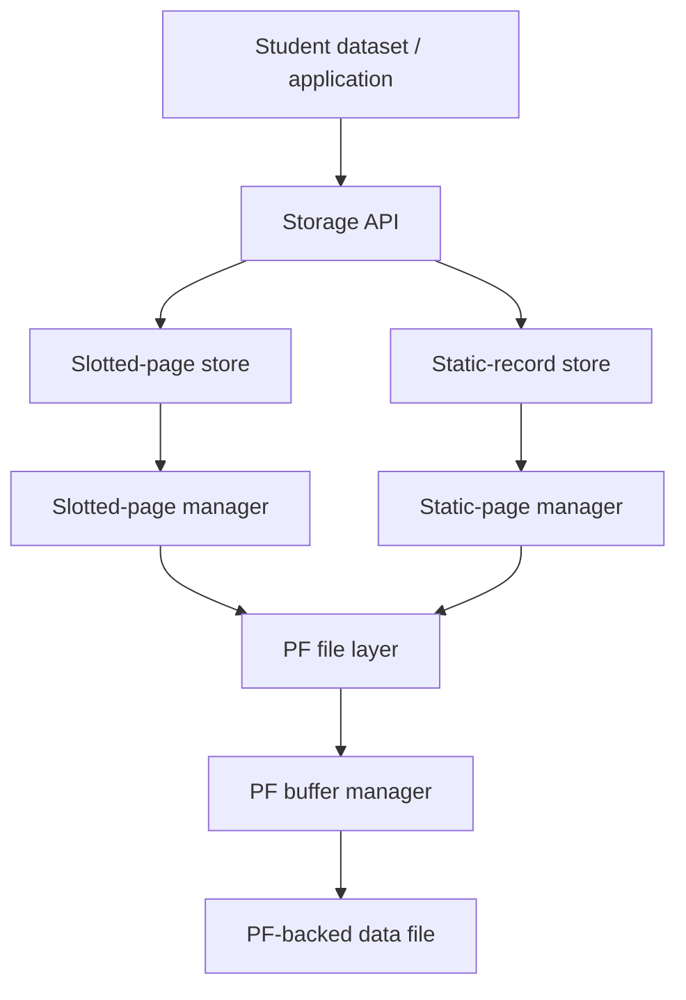
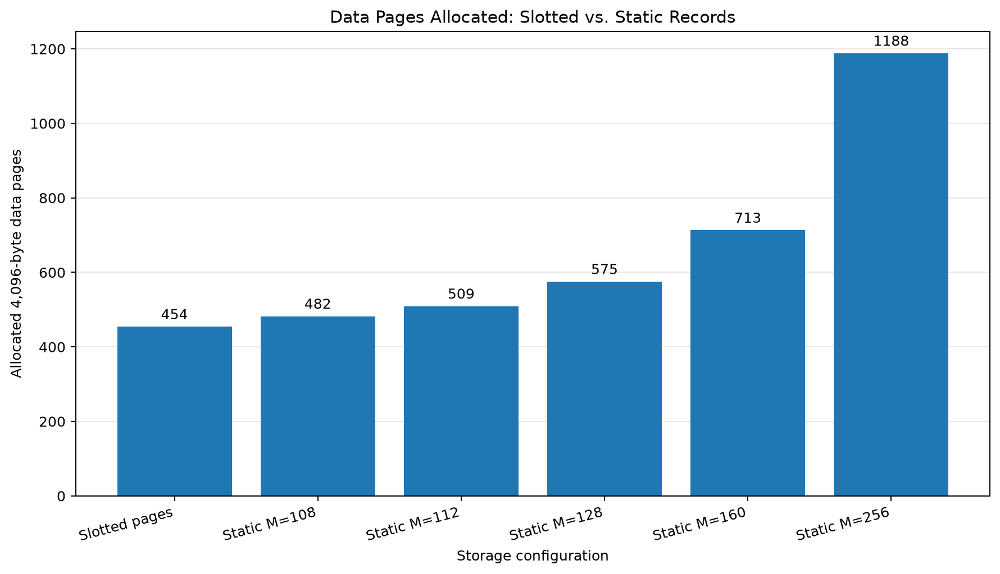
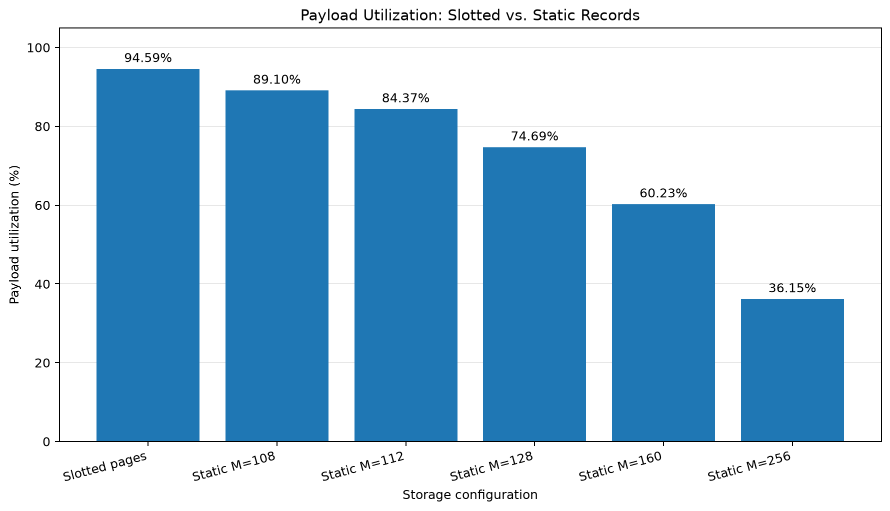

# ToyDB Storage Management
## Technical Report: Slotted Pages, Static Records, PF Integration, and Space-Utilization Experiments

**Project:** ToyDB DBMS Assignment  
**Component:** Storage management  
**Dataset:** Supplied Student relation (`data/student.txt`)  
**Page size:** 4,096 bytes  
**Implementation language:** C  
**Experiment tooling:** Python 3 and Matplotlib

**Implementation guide:** [`slottedpage/README.md`](slottedpage/README.md)

---

## Abstract

This report documents the design, implementation, validation, and experimental evaluation of two alternative Student-record storage organizations in ToyDB: variable-length slotted pages and fixed-slot static records. Both organizations are integrated with the existing Paged File (PF) layer and support persistent storage, record retrieval through record identifiers (RIDs), and sequential scanning.

The evaluation uses 17,813 records from the supplied Student dataset, representing 1,759,011 bytes of record payload after excluding the descriptive header line and line terminators. Static-record storage is evaluated at maximum record lengths of 108, 112, 128, 160, and 256 bytes. The slotted-page PF file uses 454 data pages and achieves 94.59% payload utilization. The best tested static configuration, `M=108`, uses 482 pages and achieves 89.10% payload utilization. Increasing the static maximum record length increases reserved padding and reduces payload utilization.

The report also describes the integration boundary between the storage modules and the PF buffer manager, the RID encoding shared with the AM layer, the test strategy, and the reproducible experiment pipeline. PF performance graphs and AM/B+ tree indexing experiments are tracked as separate project deliverables and are not presented as completed results here.

---

## 1. Executive Summary

The storage component implements and tests two page-level organizations for the same Student records.

### 1.1 Slotted-page storage

A slotted page contains a 12-byte header, a forward-growing array of 4-byte slot descriptors, and packed record bytes growing backward from the end of the page. Each slot stores a record's offset and actual length. Deletion leaves a tombstone so that the slot number of every surviving record remains stable. Compaction reclaims fragmented record space while preserving slot identifiers.

The page-level implementation is integrated with PF through `student_store.c/.h`. This wrapper provides PF-backed file creation/open/close, insertion, RID-based retrieval, deletion, compaction, and callback-driven sequential scanning.

### 1.2 Static-record storage

Static storage uses an 8-byte page header and fixed-size slots. Each slot reserves `M` bytes for record data and stores a 2-byte actual-length field. The maximum slot capacity is:

$$
C(M) = \left\lfloor\frac{4096-8}{M+2}\right\rfloor
$$

The implementation was tested for `M = 108, 112, 128, 160, 256`.

### 1.3 Experimental conclusion

| Configuration | PF pages | Allocated data-page bytes | Payload utilization |
|---|---:|---:|---:|
| Slotted pages | **454** | **1,859,584** | **94.59%** |
| Static `M=108` | 482 | 1,974,272 | 89.10% |
| Static `M=112` | 509 | 2,084,864 | 84.37% |
| Static `M=128` | 575 | 2,355,200 | 74.69% |
| Static `M=160` | 713 | 2,920,448 | 60.23% |
| Static `M=256` | 1,188 | 4,866,048 | 36.15% |

For the supplied dataset, slotted pages use 28 fewer pages than the best tested static configuration (`M=108`), a 5.81% reduction relative to that static page count. Payload utilization is higher by 5.49 percentage points.

These are space-allocation results. They do not, by themselves, prove that slotted pages are faster for all workloads.

---

## 2. Scope, Objectives, and Current Project Status

### 2.1 Storage objectives addressed

The storage work covers:

1. A 4,096-byte slotted-page format for variable-length records.
2. Insertion, retrieval, deletion, tombstone reuse, and compaction.
3. PF integration and persistent Student-file storage.
4. RID-based retrieval and sequential scanning.
5. A static-record alternative with configurable maximum slot length.
6. Dataset-level validation and a comparison of space usage.

### 2.2 Status boundary

The slotted-page and static-record implementations and their storage experiments are complete and have been rerun successfully in the integrated branch containing the shared PF changes.

The PF buffer manager includes configurable buffer capacity and LRU/MRU selection. Its correctness tests have passed. Final PF workload statistics and performance graphs are tracked separately.

The AM/B+ tree tasks—existing-file index construction, incremental insertion validation, sorted bulk loading, internal-node/root construction, duplicate-key tests, and index benchmarking—are also separate deliverables. They are not included as completed implementation or experimental results in this storage report.

---

## 3. System Architecture

### 3.1 Layered design

The storage design separates page organization from file management.



The page-level functions operate on a caller-provided 4,096-byte buffer. They do not open or write files. The store-level wrappers obtain PF pages, invoke the page-level functions, and unfix the pages with the appropriate dirty flag.

### 3.2 Main source modules

| File | Responsibility |
|---|---|
| `slotted_page.c/.h` | Page initialization, insertion, retrieval, deletion, compaction, and validation for variable-length records |
| `student_store.c/.h` | PF-backed slotted Student file and sequential scan |
| `static_page.c/.h` | Fixed-slot page initialization, insertion, retrieval, and metadata |
| `static_store.c/.h` | PF-backed static-record store, scan, and storage statistics |
| `rid.h` | Shared page-number/slot-number RID encoder and decoder |
| `pf_api.h` | Typed declarations matching the legacy PF layer |
| `pflayer/pf.c` | PF file operations and page allocation/retrieval |
| `pflayer/buf.c` | PF buffer management, dirty-page handling, and replacement policy |
| `experiments/storage/generate_storage_comparison.py` | Reproducible storage experiment runner and graph generation |

### 3.3 PF and buffer-manager boundary

The PF layer manages pages belonging to a PF file. The buffer manager holds a limited number of those pages in memory. In the shared PF implementation, the buffer capacity and replacement policy are configurable, with LRU and MRU supported.

The storage-space experiment counts **allocated PF data pages**. It does not count buffer frames. LRU/MRU selection can affect the number of PF-layer reads and writes under a workload, but it does not change the page format or the deterministic number of data pages needed to store this dataset.

The PF implementation exposes `PFbufSetCapacity()` and `PFbufSetPolicy()`. `PF_LRU` and `PF_MRU` select the replacement policy; the default policy is LRU and the default capacity is `PF_MAX_BUFS` (20 frames). The statistics interface exposes logical reads/writes, physical reads/writes, and buffer hits. The final PF workload graphs and interpretation are tracked separately from the storage-space experiment.

This distinction is important: the storage comparison in this report is not an LRU-versus-MRU performance experiment.

### 3.3 PF page-file representation

The storage modules work with a 4,096-byte PF page buffer. In the tested Linux build, each stored PF page also carries a 4-byte `nextfree` integer field, and the PF file begins with an 8-byte header. The estimated PF file size is:

$$
\text{PF file bytes} = (\text{data pages} \times 4096) + (\text{data pages} \times 4) + 8
$$

Payload utilization is calculated over allocated 4,096-byte data-page areas only. The PF wrapper and file-header bytes are additional file-format overhead and are not part of the payload-utilization denominator.

---

## 4. Dataset Description and Input Handling

The supplied Student file is located at `data/student.txt`.

| Property | Measured value |
|---|---:|
| Data records, excluding first descriptive line | 17,813 |
| Record payload, excluding line terminators | 1,759,011 bytes |
| Average payload per record | Approximately 98.75 bytes |
| PF page size | 4,096 bytes |

The dataset test programs skip the first descriptive line. They remove `\n` and `\r` from each record before insertion and ignore empty trailing lines. The Python experiment runner independently reads the source file, counts the records, sums the record bytes, and validates the expected 16-field semicolon-separated structure.

The measured payload is the sum of the Student record bytes only. CR/LF line terminators are not stored as part of the records and are therefore excluded from the payload calculation.

---

## 5. Slotted-Page Design

### 5.1 Page layout

Every slotted page is 4,096 bytes.

The page header is 12 bytes:

| Header field | Width | Meaning |
|---|---:|---|
| Magic value | 4 bytes | Identifies a valid slotted page |
| `slot_count` | 2 bytes | Number of slot descriptors, including deleted slots |
| `live_count` | 2 bytes | Number of non-deleted records |
| `free_start` | 2 bytes | Beginning boundary of the contiguous free region |
| `free_end` | 2 bytes | End boundary of the contiguous free region |
| **Total** | **12 bytes** | |

Each slot descriptor is 4 bytes:

| Slot field | Width | Meaning |
|---|---:|---|
| `offset` | 2 bytes | Starting byte offset of the record within the page |
| `length` | 2 bytes | Actual record length; zero indicates a tombstone |

The slot directory grows from the beginning of the page toward higher offsets. Record payload bytes are placed from the end of the page toward lower offsets.

```text
Offset 0                                                         Offset 4095
┌─────────────────────┬──────────────────────┬────────────────────────────┐
│ 12-byte header      │ Slot directory       │ Variable-length records    │
│                     │ grows forward  --->  │ packed from page end  <--- │
└─────────────────────┴──────────────────────┴────────────────────────────┘
                      ^ free_start              free_end ^
                         contiguous free bytes
```

`free_start` is determined by the header and slot-directory size. `free_end` identifies the boundary of the packed record region.

### 5.2 Insertion algorithm

For each insertion, `SP_InsertRecord()`:

1. Checks pointers, record length, and page validity.
2. Validates header metadata and live record boundaries.
3. Searches the slot directory for a tombstone.
4. Reuses the first deleted slot if one exists; otherwise, it allocates a new slot descriptor.
5. Computes the required space: record length, plus 4 bytes if a new descriptor is required.
6. Tests the contiguous free region.
7. If a fragmented page can fit the record after compaction, compacts and retries.
8. Copies the record bytes into the page, writes the slot descriptor, and updates the header.

The key space distinction is:

- **Reusing a tombstone:** no new slot descriptor is needed.
- **Creating a new slot:** an additional 4-byte descriptor is required.

The implementation therefore avoids unnecessarily growing the directory when a deleted slot is available.

### 5.3 Deletion and stable slot identifiers

Deletion marks the selected slot as:

```text
offset = 0
length = 0
```

The deleted record's former byte range is not necessarily reclaimed immediately. `live_count` decreases, but `slot_count` remains unchanged. This preserves the slot numbers of all other records.

This design is important for RID stability. If deletion compacted the directory by removing a descriptor, later slots would shift and previously issued RIDs could identify a different record.

### 5.4 Compaction

`SP_CompactPage()` rebuilds the page's record region using only live records:

1. It preserves the existing slot-directory positions.
2. It copies live record bytes into a compact region.
3. It updates each live slot's offset.
4. It leaves tombstones in their original slot positions.
5. It restores the page metadata consistently.

Compaction reclaims fragmentation while preserving slot numbers. The insert path can invoke compaction automatically when enough total free space exists but the current contiguous region is too small.

### 5.5 Validation

The page validator checks the magic value, header bounds, slot-directory boundary, live and total slot counts, record bounds, and overlap between live record regions. It rejects malformed pages and invalid or deleted slots rather than treating arbitrary bytes as records.

---

## 6. PF-Backed Slotted Student Store

### 6.1 Store lifecycle

The store API is implemented in `student_store.c/.h`.

A typical application lifecycle is:

1. Call `PF_Init()` once for the process.
2. Create a PF file with `SPStore_CreateFile()`.
3. Open it with `SPStore_Open()`.
4. Insert, retrieve, delete, compact, or scan records.
5. Close it with `SPStore_Close()`.

When a store is opened, the implementation traverses the existing PF pages, validates that they contain slotted pages, and remembers the last data page. This supports append recovery after closing and reopening the file.

### 6.2 Insert path

For insertion:

1. Fix the current PF page using `PF_GetThisPage()`.
2. Call `SP_InsertRecord()`.
3. If insertion succeeds, unfix the page with `dirty = TRUE`.
4. If the page is full, unfix it without marking it dirty.
5. Allocate a new PF page using `PF_AllocPage()`.
6. Initialize the page using `SP_InitPage()`.
7. Insert the record and mark the page dirty when unfixing it.
8. Encode and return the RID.

The dirty flag is significant: PF must be told when a page has changed so that the buffer manager can write it back when required.

### 6.3 RID encoding

The shared RID format is:

$$
RID = (pageNum \ll 10) \;|\; (slotNum + 1)
$$

The lower 10 bits store `slotNum + 1`. Zero is reserved as an invalid slot code. Decoding is:

```c
pageNum = rid >> 10;
slotNum = (rid & 1023) - 1;
```

The RID is a physical locator consisting of a PF page number and a zero-based slot number. It is not the Student roll-number key.

This integer format is used to maintain compatibility with the AM layer's RID interface.

### 6.4 Retrieval path

`SPStore_Get()` decodes the RID, fixes the referenced PF page, calls `SP_GetRecord()` for the decoded slot, and unfixes the page without marking it dirty. The returned bytes and actual record length are checked by the dataset test.

### 6.5 Sequential scan

`SPStore_Scan()` visits used PF pages in page order and slots in slot order:

1. Obtain the first page with `PF_GetFirstPage()`.
2. Read the slot count.
3. Attempt to retrieve each slot.
4. Skip deleted slots/tombstones.
5. Encode a RID for each live record.
6. Invoke the supplied callback.
7. Unfix the current page with `dirty = FALSE`.
8. Move to the next page with `PF_GetNextPage()`.

The callback can request continuation, successful early termination, or an error. The callback's record buffer is valid only while the callback is executing; data must be copied if it needs to be retained.

---

## 7. Static-Record Design

### 7.1 Page layout

Static pages use an 8-byte header:

| Header field | Width | Meaning |
|---|---:|---|
| Magic value | 4 bytes | Identifies the static page format |
| Maximum record length `M` | 2 bytes | Configured reserved record area |
| Record count | 2 bytes | Number of records stored on the page |
| **Total** | **8 bytes** | |

Each record slot stores a 2-byte actual-length field followed by a reserved `M`-byte data region:

```text
┌───────────────────────────┬────────────────────────────────────────┐
│ 2-byte actual record size │ M-byte reserved record payload area    │
└───────────────────────────┴────────────────────────────────────────┘
```

If a record uses fewer than `M` bytes, the rest of the reserved area is padding. The actual-length prefix allows retrieval to return only the record's meaningful bytes.

### 7.2 Page capacity

The slot size is `M + 2` bytes. Given an 8-byte page header and a 4,096-byte page:

$$
C(M) = \left\lfloor\frac{4096-8}{M+2}\right\rfloor
$$

| `M` | Slot size | Maximum records per full page |
|---:|---:|---:|
| 108 | 110 bytes | 37 |
| 112 | 114 bytes | 35 |
| 128 | 130 bytes | 31 |
| 160 | 162 bytes | 25 |
| 256 | 258 bytes | 15 |

The number of PF data pages expected for `N` records is:

$$
Pages(M) = \left\lceil\frac{N}{C(M)}\right\rceil
$$

For `N = 17,813`, this gives 482, 509, 575, 713, and 1,188 pages for the five tested maximum record lengths, matching the PF-backed test output.

### 7.3 Static store operations

`static_store.c/.h` wraps the static page functions with PF file operations. It supports creating/opening/closing the static data file, appending records, retrieving by RID, scanning records, and collecting storage statistics.

The static store uses the same RID encoding as the slotted store, allowing the same page/slot concept to be passed through the AM-facing integer RID representation.

---

## 8. Experimental Methodology

### 8.1 Workload

Both record organizations were evaluated using the same 17,813 Student records and the same actual payload total of 1,759,011 bytes.

The slotted-page measurement is based on the PF-backed Student file. `test_student_pf` traverses the actual PF file and reports the number of allocated data pages. The in-memory `test_student_dataset` result is used as a cross-check; the experiment script requires the two counts to match.

For each static `M` value, `test_static_pf` inserts all records, closes and reopens the file, scans all records, verifies every saved RID retrieval, and reports the page/storage measurements.

### 8.2 Metrics

**Allocated data-page bytes**

$$
A = Pages \times 4096
$$

**Payload utilization**

$$
U_p = \frac{Payload}{A}\times100
$$

**Slotted-page overhead**

$$
H_s = 12(Pages) + 4(N)
$$

**Slotted occupied page bytes**

$$
O_s = Payload + H_s
$$

**Static reserved record bytes**

$$
R_M = N \times M
$$

**Static record padding**

$$
P_M = R_M - Payload
$$

**Static record-length metadata**

$$
L = 2N
$$

**Static occupied page bytes**

$$
O_M = R_M + L + 8(Pages)
$$

**Unused data-page bytes**

$$
F = A - O
$$

Payload utilization deliberately counts only actual Student bytes in the numerator. Slot descriptors, page headers, actual-length fields, and reserved padding are overhead.

### 8.3 Automated experiment pipeline

The script `experiments/storage/generate_storage_comparison.py` makes the experiment reproducible. It:

1. Locates and validates `student.txt`.
2. Executes `make clean`.
3. Runs the in-memory slotted dataset test.
4. Runs the PF-backed slotted insert/close/reopen/RID test.
5. Runs the full PF-backed slotted sequential scan.
6. Runs static page tests.
7. Runs PF-backed static tests for all five `M` values.
8. Saves all test output to `storage_test_results.txt`.
9. Parses measurements from the C test output.
10. Checks record counts, page counts, and byte-accounting equations.
11. Generates `storage_comparison.csv`.
12. Generates the page-allocation and payload-utilization graphs.
13. Generates `storage_comparison_notes.md`.

The slotted PF page count is extracted from `test_student_pf`; the in-memory page count is only a cross-check. Static page counts are extracted from the corresponding PF-backed static test outputs. The script does not insert the page-count measurements into the graph from handwritten constants.

---

## 9. Experimental Results

### 9.1 Summary table

| Configuration | Capacity / average | PF pages | Allocated data-page bytes | Payload utilization |
|---|---:|---:|---:|---:|
| Slotted pages | 39.24 records/page average | **454** | **1,859,584** | **94.59%** |
| Static `M=108` | 37 slots/page capacity | 482 | 1,974,272 | 89.10% |
| Static `M=112` | 35 slots/page capacity | 509 | 2,084,864 | 84.37% |
| Static `M=128` | 31 slots/page capacity | 575 | 2,355,200 | 74.69% |
| Static `M=160` | 25 slots/page capacity | 713 | 2,920,448 | 60.23% |
| Static `M=256` | 15 slots/page capacity | 1,188 | 4,866,048 | 36.15% |

### 9.2 Detailed accounting table

**Record-area accounting**

| Format | Payload bytes | Reserved record bytes | Record padding | Length metadata |
|---|---:|---:|---:|---:|
| Slotted | 1,759,011 | 1,759,011 | 0 | 0 |
| Static 108 | 1,759,011 | 1,923,804 | 164,793 | 35,626 |
| Static 112 | 1,759,011 | 1,995,056 | 236,045 | 35,626 |
| Static 128 | 1,759,011 | 2,280,064 | 521,053 | 35,626 |
| Static 160 | 1,759,011 | 2,850,080 | 1,091,069 | 35,626 |
| Static 256 | 1,759,011 | 4,560,128 | 2,801,117 | 35,626 |

**Page-structure accounting**

| Format | Page headers | Slot directory | Occupied page bytes | Unused page bytes |
|---|---:|---:|---:|---:|
| Slotted | 5,448 | 71,252 | 1,835,711 | 23,873 |
| Static 108 | 3,856 | 0 | 1,963,286 | 10,986 |
| Static 112 | 4,072 | 0 | 2,034,754 | 50,110 |
| Static 128 | 4,600 | 0 | 2,320,290 | 34,910 |
| Static 160 | 5,704 | 0 | 2,891,410 | 29,038 |
| Static 256 | 9,504 | 0 | 4,605,258 | 260,790 |

The table distinguishes two types of space waste:

- **Record padding** is inside the reserved static slots. It is counted as occupied slot space, but it does not contain Student payload.
- **Unused page bytes** are the remaining bytes in allocated PF data pages after subtracting the page structures and reserved slots.

This distinction explains why a configuration can have large record padding but relatively few unused page bytes: the padding is already inside the reserved slots.

### 9.3 Generated graph: allocated pages



### 9.4 Generated graph: payload utilization



The source measurements and full experiment output are retained in:

- `experiments/storage/storage_comparison.csv`
- `experiments/storage/storage_test_results.txt`
- `experiments/storage/storage_comparison_notes.md`

The estimated PF file sizes, including the 4-byte per-page wrapper field and 8-byte file header, are:

| Configuration | Estimated PF file size |
|---|---:|
| Slotted pages | 1,861,408 bytes |
| Static `M=108` | 1,976,208 bytes |
| Static `M=112` | 2,086,908 bytes |
| Static `M=128` | 2,357,508 bytes |
| Static `M=160` | 2,923,308 bytes |
| Static `M=256` | 4,870,808 bytes |

The static-file estimates agree with earlier retained-file `stat` checks. The primary comparison metric remains payload bytes divided by allocated 4,096-byte data-page bytes.

---

## 10. Analysis and Discussion

### 10.1 Page-count comparison

Slotted pages allocate 454 PF data pages. Static `M=108`, the best of the tested static settings, allocates 482 pages.

The difference is:

$$
482 - 454 = 28 \text{ pages}
$$

Relative to the static `M=108` page count:

$$
\frac{482-454}{482}\times100 \approx 5.81\%
$$

The slotted implementation therefore uses 28 fewer pages, or approximately 5.81% fewer data pages, than the best tested static configuration.

### 10.2 Payload-utilization comparison

For slotted pages:

$$
U_{slotted} =
\frac{1,759,011}{454\times4,096}\times100
\approx 94.59\%
$$

For static `M=108`:

$$
U_{108} =
\frac{1,759,011}{482\times4,096}\times100
\approx 89.10\%
$$

The difference is approximately:

$$
94.59 - 89.10 = 5.49
$$

Thus, slotted storage improves payload utilization by about **5.49 percentage points** for this dataset.

### 10.3 Effect of increasing the static maximum record length

Static storage reserves `M` bytes per record, regardless of the record's actual length. Increasing `M` has two linked effects:

1. The slot size `M+2` increases.
2. Fewer slots fit in one 4,096-byte page.

As a result, the number of allocated pages grows from 482 at `M=108` to 1,188 at `M=256`. Record padding also grows from 164,793 bytes to 2,801,117 bytes.

The largest tested configuration therefore allocates more than twice as many pages as slotted storage and has only 36.15% payload utilization.

### 10.4 Why the slotted-page directory is worthwhile

Slotted pages pay for a 4-byte offset/length descriptor per slot and a 12-byte page header. In return, they store each record at its actual length and do not reserve the same maximum-width area for every record.

For variable-length Student records, that trade-off is favourable in the measured dataset. The page directory allows records to be located even though the payloads have different lengths. Tombstones and compaction allow deletion without renumbering surviving slots.

### 10.5 Scope of the conclusion

The experiment demonstrates space efficiency for the supplied Student dataset and the tested static values of `M`. It does not measure CPU time, insertion latency, lookup latency, deletion cost, or sequential-scan throughput. Those would require separate performance workloads and measurements.

The result should therefore be stated narrowly: **slotted pages are more space-efficient than the tested static-record configurations for this Student dataset under the payload-utilization and page-count metrics used here.**

---

## 11. Testing and Validation

### 11.1 Page-level slotted-page tests

The page-level tests cover initialization, header metadata, variable-length insertion, retrieval, invalid inputs, full-page handling, tombstone creation, slot reuse, compaction, stable slot identifiers, and malformed/overlapping page detection.

The Phase 2 regression suite reports **7/7 tests passed**.

### 11.2 PF integration tests

The PF integration tests validate:

- PF file creation and page allocation.
- Multi-page record insertion.
- RID-based retrieval across pages.
- Close/reopen persistence.
- Append recovery after reopening.
- Deletion and compaction persistence.
- Reuse of deleted slots/RIDs after reopening.

A synthetic PF integration test inserts 250 records and verifies an append after reopening.

### 11.3 Full Student dataset: slotted storage

The PF-backed Student test:

1. Reads the dataset, skipping its descriptive first line.
2. Inserts each Student row.
3. Saves the RIDs and original record bytes.
4. Closes and reopens the PF file.
5. Retrieves each record through its RID.
6. Compares the retrieved bytes and lengths against the original input.

All **17,813 records** were verified. The test also traverses PF pages to count the actual PF data pages. The measured PF count is 454 and matches the in-memory slotted-page count.

### 11.4 Sequential scan tests

The synthetic scan test inserts 250 records, deletes 4, and verifies that 246 live records are returned. It also tests empty files, multiple pages, deletion/compaction, persistence across reopen, RID/record matching, and callback-controlled early termination.

The full dataset scan returns all 17,813 records, with **zero missing or extra records**.

### 11.5 Static-record tests

The page-level tests pass for `M=108,112,128,160,256`.

For every PF-backed static configuration:

- 17,813 records are inserted.
- The file is closed and reopened.
- 17,813 records are scanned.
- 17,813 RID-based retrievals are verified.
- No missing, extra, or mismatched records are reported.

### 11.6 Integrated regression

After the PF changes from the shared main branch were merged into the slotted-page feature branch, the storage suite and unified storage experiment were rerun successfully. The storage report's PF-backed page counts therefore come from the integrated working tree, not only the original PF implementation.

---

## 12. Reproducibility

### 12.1 Prerequisites

- Linux environment.
- C compiler and `make`.
- Python 3.
- Matplotlib.
- Supplied `data/student.txt`.

On Ubuntu:

```bash
sudo apt update
sudo apt install build-essential make python3 python3-matplotlib
```

### 12.2 Run storage regression tests

From the repository root:

```bash
cd toydb/slottedpage
make clean
make test STUDENT_FILE=../../data/student.txt
```

### 12.3 Re-run the complete storage comparison

From the repository root:

```bash
python3 toydb/experiments/storage/generate_storage_comparison.py
```

For an alternate dataset path:

```bash
python3 toydb/experiments/storage/generate_storage_comparison.py \
    --student-file /absolute/path/to/student.txt
```

The script runs the C tests, captures the output, parses the actual measurements, validates the accounting, and recreates the CSV, graphs, and notes.

### 12.4 Inspect one retained static PF file

The static PF test normally removes its temporary database after verification. To retain one test file:

```bash
cd toydb/slottedpage
./test_static_pf ../../data/student.txt 128 --keep
ls -lh static_students_M128.pf
```

Remove retained test database files after inspection; they are generated data, not source files.

---

## 13. Limitations and Work Outside This Report

The following topics are intentionally not assigned invented measurements in this report:

1. **PF performance graphs:** buffer capacity, LRU/MRU, and buffer statistics are implemented and correctness-tested, but the final PF workload-statistics graphs and their analysis are a separate deliverable.
2. **AM/B+ tree indexing:** existing-file index construction, incremental insertion verification, sorted bulk loading, internal levels/root metadata, duplicate-key behaviour, search validation, and index performance comparisons are still tracked separately.
3. **Cross-component finalization:** the completed storage branch still needs to be integrated with the final AM/indexing work, followed by a complete project-level regression and submission packaging.

These are project-scope boundaries, not claims that the storage subsystem is incomplete.

---

## 14. Conclusion

The project implements two persistent Student-record storage alternatives over the ToyDB PF layer. The slotted-page design supports variable-length records, tombstone-based deletion, slot reuse, compaction, RID retrieval, and sequential scanning. The static-record design reserves a configurable maximum record area per slot and supports PF-backed insertion, retrieval, scanning, and storage measurement.

Both designs passed their page-level and PF-backed dataset tests. All 17,813 Student records were verified, including after close/reopen. The PF-backed slotted file uses 454 pages and achieves 94.59% payload utilization. The most efficient tested static configuration (`M=108`) uses 482 pages and achieves 89.10%. Larger static slot sizes increase padding, reduce slots per page, and require substantially more pages.

For the supplied variable-length Student dataset, slotted pages provide the best space utilization among the tested configurations. The unified experiment runner preserves the provenance of the measurements by extracting the page counts and storage figures from the C test output and regenerating the CSV and graphs from those measurements.

---

## Appendix A — Key constants and equations

| Constant / equation | Value |
|---|---:|
| PF data-page size | 4,096 bytes |
| Slotted-page header | 12 bytes |
| Slotted slot descriptor | 4 bytes |
| Static-page header | 8 bytes |
| Static slot length metadata | 2 bytes |
| RID slot field | 10 low bits containing `slotNum + 1` |
| Static slots/page | `floor((4096 - 8) / (M + 2))` |
| Static pages required | `ceil(17,813 / slots_per_page)` |
| Payload utilization | `payload_bytes / allocated_data_page_bytes × 100` |

## Appendix B — Output artifacts

| Artifact | Purpose |
|---|---|
| `experiments/storage/generate_storage_comparison.py` | Runs tests and regenerates comparison artifacts |
| `experiments/storage/storage_test_results.txt` | Captured C test output |
| `experiments/storage/storage_comparison.csv` | Machine-readable result table and provenance |
| `experiments/storage/storage_pages_comparison.png` | Allocated data-page graph |
| `experiments/storage/storage_payload_utilization.png` | Payload-utilization graph |
| `experiments/storage/storage_comparison_notes.md` | Generated concise interpretation |
