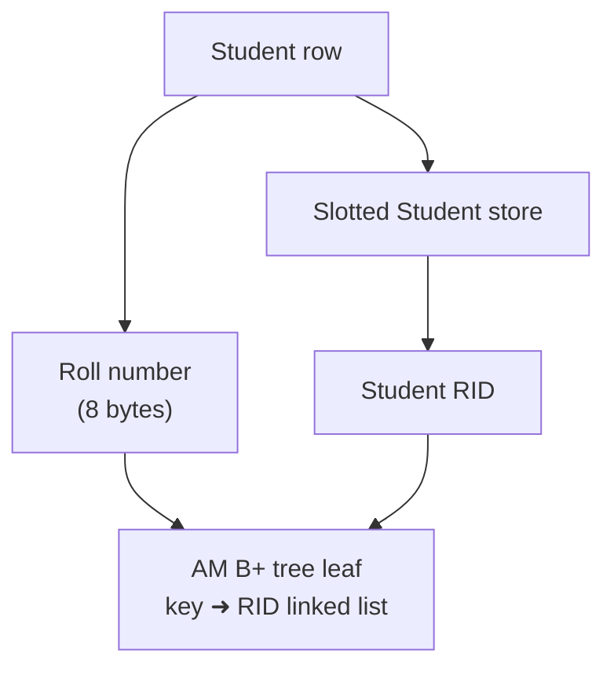
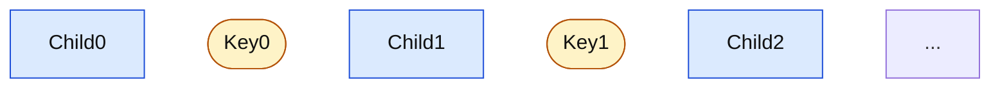
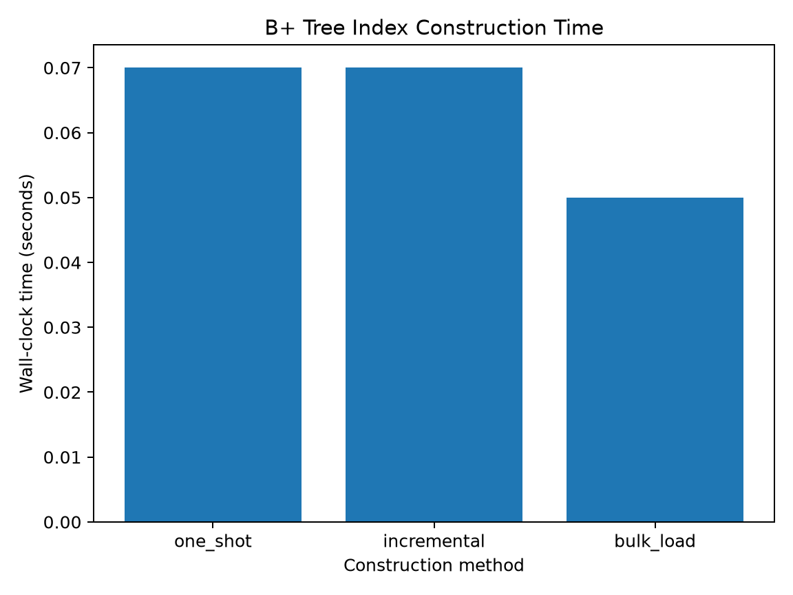
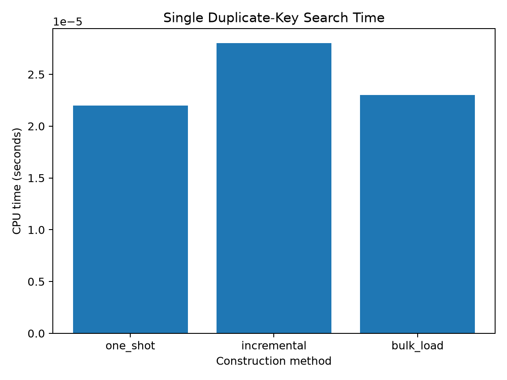
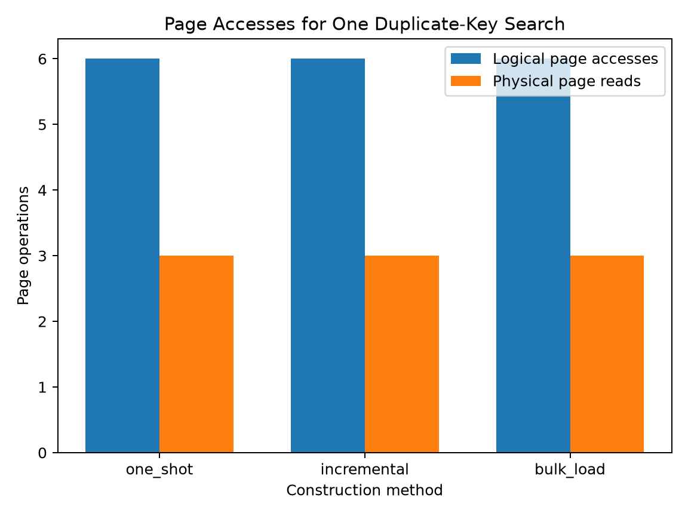

# ToyDB Access Method (AM) Layer

This README documents the Student B+ tree indexing work in ToyDB, including the three construction paths, the duplicate-aware sorted bulk loader, root/leaf layout, scan correction, regression tests, and benchmark results. The master report is [`../Technical_Report.md`](../Technical_Report.md); the focused benchmark guide is [`AM_BENCHMARK_README.md`](AM_BENCHMARK_README.md).

## 1. Role of the AM layer

The Access Method layer maps a search key to one or more record identifiers (RIDs). For the Student workload, the indexed key is the eight-character roll number extracted from the second semicolon-separated field. Student rows are stored by the slotted-page store. The AM index stores the roll-number key and the associated Student RID, not a second copy of the full row.



The common RID convention is:

```c
rid = (pageNum << 10) | (slotNum + 1);
pageNum = rid >> 10;
slotNum = (rid & 1023) - 1;
```

A RID is a physical page/slot locator in Student storage; it is not the roll-number key.

## 2. B+ tree page architecture

### 2.1 Leaf pages

A leaf page begins with `AM_LEAFHEADER`. The header records the page type (`'l'`), the next leaf page, pointers to the RID and key regions, free-list information, attribute length, key count, and maximum-key metadata.

The sorted key directory grows forward after the header. Each distinct key has a short pointer to its RID-list head. RID-list nodes are packed from the other end of the page and store an integer RID plus a short pointer to the next node. A key with multiple records therefore has one key entry and a linked list of RIDs.

The `nextLeafPage` pointer links leaves in sorted-key order. This is used by sequential/range scans after the initial leaf is located.

### 2.2 Internal page and separator convention

An internal page begins with `AM_INTHEADER` and stores child pointers interleaved with separator keys:



Each separator is the first key in the child immediately to its right. Search begins at the root, uses the internal-page binary search to select a child, repeats through internal pages if present, and then searches the leaf. The current Student bulk loader creates one internal root above its leaves; it does not create multiple internal levels.

### 2.3 AM scan model

The AM scan interface opens an index scan with an operator and optional key value, then returns RIDs through repeated `xAM_FindNextEntry()` calls until `AME_EOF`, after which the scan is closed. The `ALL` operator visits the leaf chain in order. G4 corrected how the starting leaf is discovered: the scan follows `Child0` pointers from the root rather than relying on a hard-coded PF page number.

## 3. Construction strategies

The project compares three methods:

| Method | Behaviour | Trade-off being evaluated |
|---|---|---|
| One-shot insertion | Student records are loaded, then key/RID pairs are inserted into the index | Separates data loading from index population |
| Incremental insertion | Each Student record and its key/RID pair are inserted during the load process | Maintains the index as records arrive |
| Sorted bulk loading | Student records are stored, key/RID pairs are sorted, then leaves and root are built in sorted order | Avoids repeated arbitrary-position leaf insertion for the initial build |

The benchmark compares the end-to-end construction programs. The time includes Student record-storage preparation and the method-specific index build; it is not a measurement of only the internal B+ tree insertion loop.

## 4. Sorted bulk-loader design decisions: G1-G4

### G1 - Keep duplicate-key groups in one leaf

The loader sorts `(roll number, RID)` entries and processes an entire equal-key run as a group. Before inserting a group, it calculates the space needed for the key entry, its RID-list head, and all RID-list nodes. If the group does not fit in the remaining space, the current leaf is closed and the whole group is retried on a fresh leaf. If a duplicate group cannot fit even in an empty leaf, the loader fails instead of splitting it.

**Reason:** If the same key were split across two leaves, a separator boundary could contain duplicate keys and equality search might route to only one part of the group. Keeping one key and all of its RIDs together makes the leaf-level duplicate representation unambiguous.

### G2 - Synthetic duplicate-boundary regression

The test creates 253 distinct keys followed by a duplicate group of four RIDs. The first leaf has 24 bytes left, while the complete duplicate group requires 34 bytes. The test verifies the group is moved intact to the next leaf, the preceding key remains searchable, all four duplicate RIDs are returned, and the synthetic `ALL` scan returns all 257 records.

**Reason:** The supplied Student dataset does not guarantee a duplicate group lands at exactly the leaf-page boundary. A synthetic case makes this space-boundary failure deterministic and repeatable.

### G3 - Root capacity validation

For an eight-byte roll-number key, the current internal root has capacity for 340 separator keys and 341 child pages. The root builder checks the leaf count and physical page layout before writing the root. The regression accepts exactly 341 children and rejects 342, then checks that the rejected overflow request did not modify the root page.

**Reason:** The bulk loader must not silently write separator/child pairs beyond the 4,096-byte root page. The current design supports one internal root only, so overflow is rejected safely rather than pretending to support additional tree levels.

For the supplied dataset, the loader builds 71 leaf pages and 70 separator keys, below the 341-child capacity.

### G4 - Dynamic leftmost-leaf discovery

The earlier scan implementation assumed the leftmost leaf lived at PF page 2. The corrected code starts at the root and repeatedly follows `Child0` until a leaf page is found. It validates page types/child pointers and uses a bounded descent guard. The test no longer needs to reserve an unused dummy page before the first leaf.

**Reason:** Page numbers depend on allocation order; the tree structure, not a constant page number, defines the first leaf. Following `Child0` keeps `ALL` scans correct when allocation layout changes.

## 5. Root capacity and implemented scope

The current sorted bulk loader uses one internal root with up to 340 separator keys and 341 leaf children. The root capacity test proves acceptance at the limit and safe rejection above it. The implementation does **not** build a second internal level or a general multi-level B+ tree when more than 341 leaves are needed.

The supplied Student dataset produces 71 leaves and is within this limit. The report and benchmark notes retain this limitation explicitly.

## 6. AM regression coverage

The unified AM experiment runner builds and executes:

- Legacy tests: `test1`, `test2`, `test3`.
- Full Student bulk-loader run: G1 duplicate-group correctness, known duplicate searches, and G4 full `ALL` scan.
- Synthetic `--boundary-test`: G2 boundary case plus G4 `ALL` scan.
- Synthetic `--capacity-test`: G3 exact root capacity and overflow rejection.
- One-shot, incremental, and sorted bulk-load benchmarks.

The known duplicate roll numbers in the supplied dataset are:

```text
97305818
99302001
99310001
```

Each is expected to return two RIDs. The full Student index contains 17,813 entries. The separate G2 synthetic index contains 257 entries.

G5 (additional error-handling and legacy format-string cleanup) and G6 (a separate test that dereferences every AM-returned RID and cross-checks its Student roll number) were deferred from the selected project scope.

## 7. AM benchmark results

The latest supplied result set records the following end-to-end build times:

| Method | Build time |
|---|---:|
| One-shot | 0.070 s |
| Incremental | 0.070 s |
| Sorted bulk load | 0.050 s |

The construction timer includes Student storage preparation as well as index construction. The build-time CSV contains one end-to-end value per method for this validation run, so small differences should not be presented as statistically conclusive.

The common equality query targets roll number `97305818`. Thirty independent query measurements are collected per method, each using a fresh process. The timer covers opening the scan, retrieving the matching RIDs, and closing the scan; process startup and index-file open are outside the timer.

| Method | Measurements | Median query time | Median logical page accesses | Median physical page reads | Expected matches |
|---|---:|---:|---:|---:|---:|
| One-shot | 30 | 22 μs | 6 | 3 | 2 |
| Incremental | 30 | 28 μs | 6 | 3 | 2 |
| Sorted bulk load | 30 | 23 μs | 6 | 3 | 2 |







All 90 query measurements returned two matches. The medians of logical page accesses and physical page reads are identical across the three methods for this selected key. The observed latency differences are very small and should not be generalized beyond this query and run.

## 8. Reproducing AM tests and benchmarks

From the repository root, activate the experiment environment:

```bash
python3 -m venv .venv
source .venv/bin/activate
python -m pip install -r toydb/experiments/storage/requirements.txt
```

Run the complete AM workflow:

```bash
python toydb/experiments/storage/run_am_experiments.py --force
```

This runner creates a temporary copy of the AM, PF, slotted-page, and dataset directories; it builds and runs the legacy tests, G1-G4 bulk-loader tests, and benchmark; then it writes results under:

```text
toydb/experiments/storage/am_layer/
    build_time.csv
    query_metrics.csv
    am_benchmark_results.xlsx
    am_layer_notes.md
    graphs/
```

The lower-level benchmark script can also be run directly from `toydb/amlayer`:

```bash
cd toydb/amlayer
chmod +x run_am_benchmarks.sh
./run_am_benchmarks.sh
```

That direct script writes its intermediate benchmark files to `toydb/amlayer/benchmark_results/`. For the consolidated, temporary-copy workflow and G1-G4 regression coverage, prefer `run_am_experiments.py`.

The root Makefile also provides:

```bash
make test-am
make test
```

## 9. Source modules

| File | Responsibility |
|---|---|
| `am.c` | AM index/file lifecycle and shared access-method operations |
| `am.h` | Leaf/internal header definitions, scan operators, constants, and error codes |
| `amsearch.c` | Internal-node routing and leaf key search |
| `aminsert.c` | Leaf key insertion and RID-list management |
| `amscan.c` | Index scan state and traversal of leaf chains |
| `amstack.c` | Traversal/backtracking stack support used by AM operations |
| `test_student_am_bulk.c` | Student-specific sorted bulk-loader, root creation, and G1-G4 regressions |
| `run_am_benchmarks.sh` | Existing benchmark build/query orchestration |
| `../experiments/storage/run_am_experiments.py` | Isolated regression/benchmark runner and output generation |

## 10. Limitations

- The sorted bulk loader builds one internal root above the leaves, not multiple internal levels.
- The query experiment targets one duplicated roll number and does not establish comparative latency for every key or scan operator.
- Build timing is end-to-end and includes Student record-storage preparation.
- G5 additional cleanup and G6 RID-to-payload cross-verification were deferred.
- The 340-separator root capacity is specific to the current 4,096-byte page and eight-byte roll-number key format.

For PF buffer architecture and experiments, see [`../pflayer/README.md`](../pflayer/README.md). For physical Student record layout and RID storage, see [`../slottedpage/README.md`](../slottedpage/README.md).
