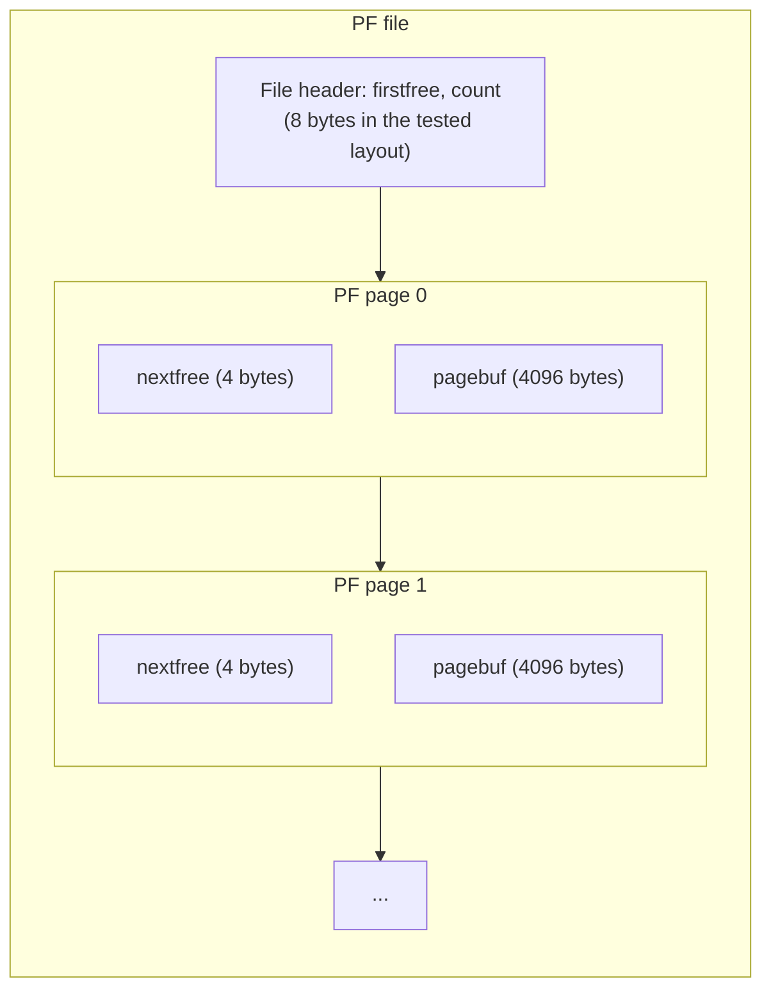
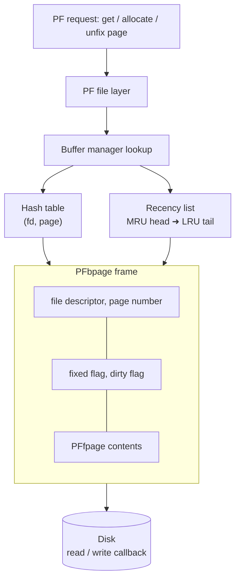
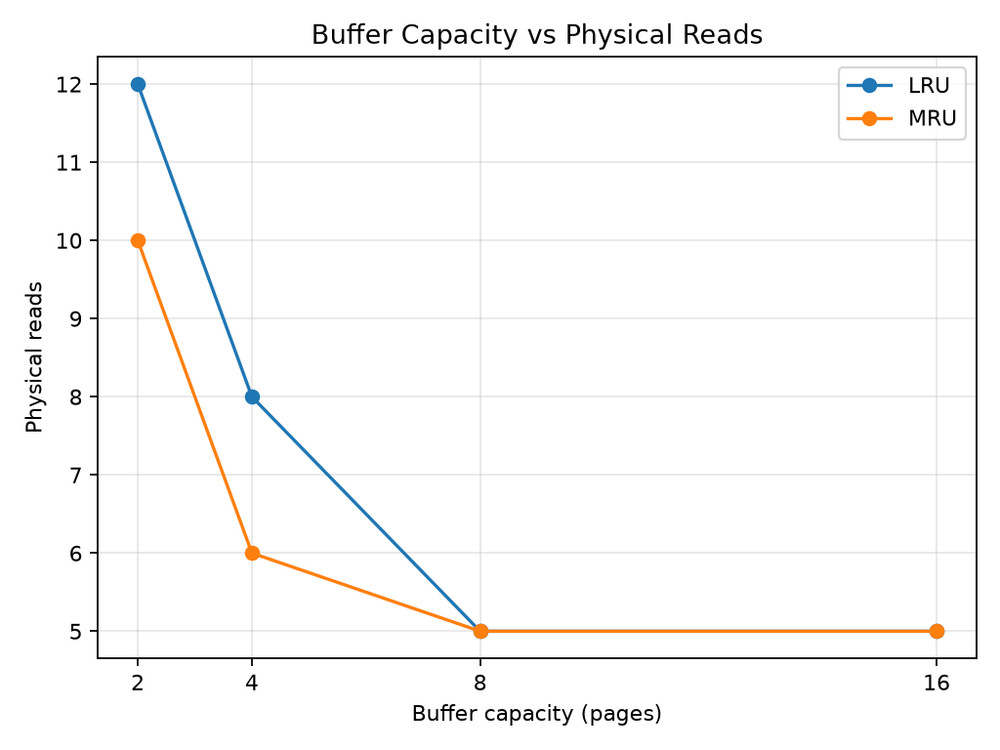
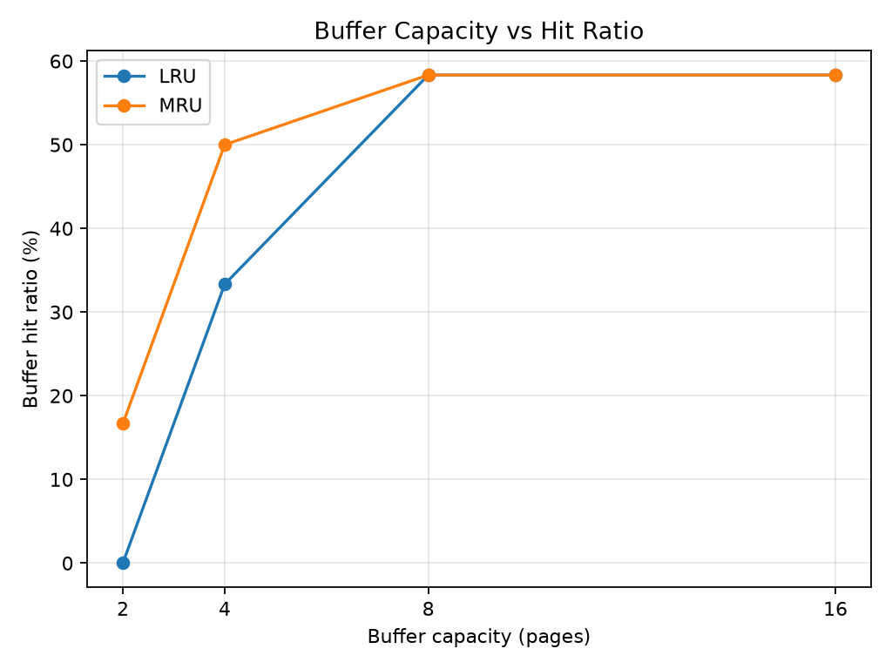
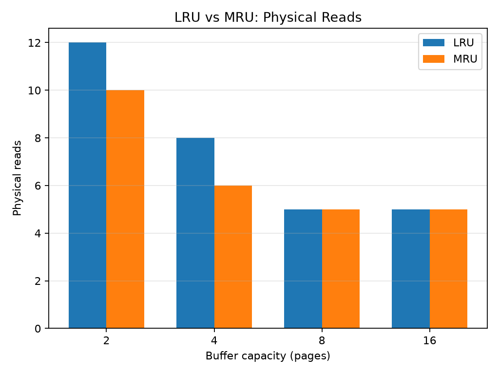
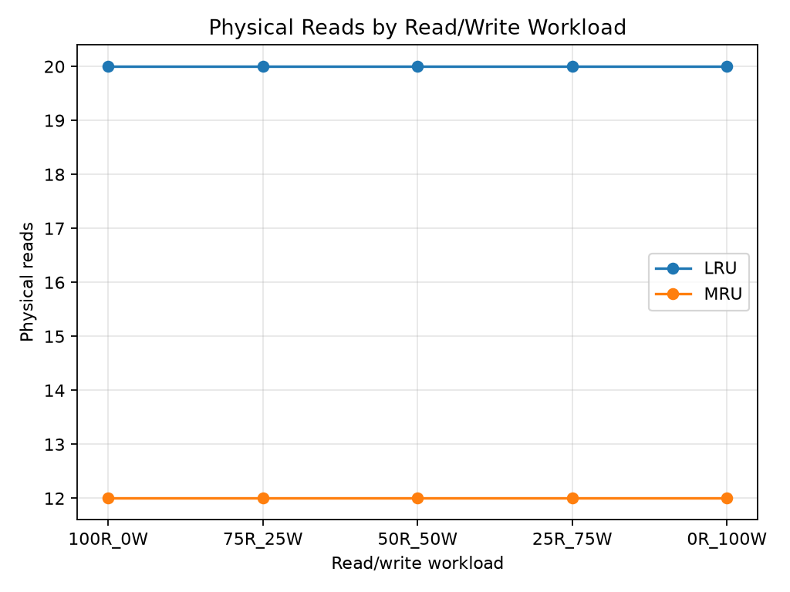
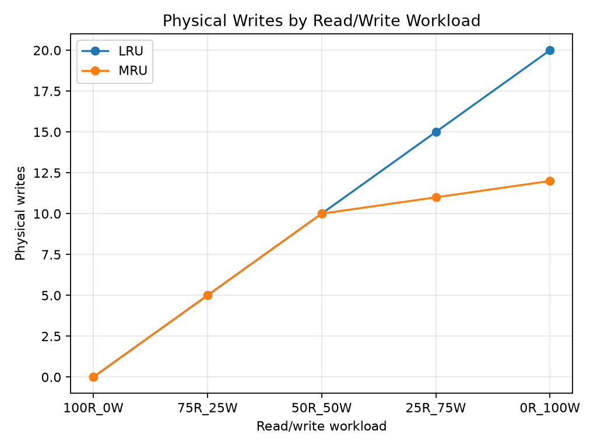

# ToyDB Paged File (PF) Layer and Buffer Manager

This README documents the PF file/page interface and the buffer-management work integrated into ToyDB. The PF layer is shared by the slotted/static Student stores and by AM index files. The full project report is [`../Technical_Report.md`](../Technical_Report.md).

## 1. Responsibilities

The PF layer provides:

- PF file creation, destruction, open, and close.
- Page allocation, lookup, disposal, and unfix operations.
- A bounded in-memory page buffer.
- Buffer-frame replacement with LRU and MRU policies.
- Protection for pages that are currently fixed/pinned.
- Dirty-page tracking and writeback.
- Buffer I/O statistics for correctness tests and experiments.

The page managers above PF receive a pointer to the 4,096-byte page data area. They do not need to know how the PF file is laid out on disk or which buffer frame currently contains a page.

## 2. PF file and page representation

The PF file header contains two integers: the first-free page pointer and the number of pages. Each stored page has a four-byte `nextfree` field followed by the page buffer.



The `nextfree` integer supports PF free-page management. The higher-level slotted, static, and AM formats occupy the 4,096-byte `pagebuf`; they do not overwrite the PF wrapper field.

## 3. Buffer-manager architecture

The buffer manager uses three structures:

1. **Buffer frames (`PFbpage`)** - each frame records the owning file descriptor, page number, PF page contents, and `fixed`/`dirty` state.
2. **Hash table** - keyed by `(file descriptor, page number)`, used to locate a resident page without scanning the full frame list.
3. **Doubly linked recency list** - tracks frame recency. The head is the most-recent end; the tail is the least-recent end.



A frame marked `fixed` cannot be evicted because a caller may still be using its page buffer. When no free frame remains, the victim search skips fixed frames. If all frames are fixed, the allocator returns a buffer-exhaustion error rather than evicting a page still in use.

## 4. Capacity and replacement policies

The maximum supported buffer capacity remains `PF_MAX_BUFS` (20). The default capacity is 20 frames and the default replacement policy is LRU.

The implementation exposes:

```c
PFbufSetCapacity(int capacity);
PFbufSetPolicy(int policy);
```

Supported policies:

| Constant | Value | Victim selection |
|---|---:|---|
| `PF_LRU` | 0 | Search from the recency-list tail and select the least-recently-used unfixed frame. |
| `PF_MRU` | 1 | Search from the recency-list head and select the most-recently-used unfixed frame. |

Capacity must be positive and no greater than 20. The setter also rejects a new limit below the number of buffer frames already allocated. A dirty victim is written through the PF write callback before it is reused. Dirty pages are also flushed during file close/release.

**Why support both policies?** LRU is the default and a conventional recency-based baseline. MRU is included so that the same access sequence can demonstrate how a different victim choice changes misses and writeback. The experiment results are workload-specific; neither policy is claimed to be universally better.

## 5. Buffer statistics

The implementation provides statistics reset, retrieval, and printing functions. The experiment outputs distinguish:

- `logical_reads`: page requests counted by the PF buffer/page interface.
- `logical_writes`: dirty unfix operations in the read/write workload.
- `physical_reads`: pages read from the PF file into the buffer.
- `physical_writes`: dirty pages written back to the PF file.
- `buffer_hits`: requests satisfied by an already-resident page.
- `hit_ratio`: `buffer_hits / logical_reads * 100` under the workload's definition of logical reads.

In the read/write workload test, `PF_GetThisPage()` is called once for every operation, even when the operation later modifies the page. Therefore `logical_reads` is 20 for every 20-operation mix. `read_operations` and `write_operations` are separate columns that express the intended workload mix. Dirty pages are written on eviction or close; the test collects physical-write statistics after closing the file so close-time flushing is included.

## 6. Correctness tests

The unified PF experiment runner executes five correctness tests in a temporary build copy:

| Test | Coverage |
|---|---|
| `testhash` | Hash lookup and page mapping behaviour |
| `testpf` | PF file operations, page allocation, disposal, retrieval, and iteration |
| `testbuf` | Configured capacity, fixed-page protection, hits, dirty eviction, close-time flush, policy selection, invalid configuration, and stats reset |
| `teststats` | Logical/physical I/O counters and buffer-hit accounting |
| `testlru` | Strict LRU victim selection |

All five tests passed in the supplied validation result (`pf_test_summary.csv`). The PF Makefile also builds and executes `testexperiment` and `testworkload` for the performance workloads.

## 7. Capacity and replacement-policy experiment

The capacity experiment replays this exact 12-request sequence:

```text
0, 1, 2, 3, 0, 1, 4, 0, 1, 2, 3, 4
```

It compares LRU and MRU with capacities 2, 4, 8, and 16 pages.

| Policy | Capacity | Logical reads | Physical reads | Hits | Hit ratio |
|---|---:|---:|---:|---:|---:|
| LRU | 2 | 12 | 12 | 0 | 0.00% |
| LRU | 4 | 12 | 8 | 4 | 33.33% |
| LRU | 8 | 12 | 5 | 7 | 58.33% |
| LRU | 16 | 12 | 5 | 7 | 58.33% |
| MRU | 2 | 12 | 10 | 2 | 16.67% |
| MRU | 4 | 12 | 6 | 6 | 50.00% |
| MRU | 8 | 12 | 5 | 7 | 58.33% |
| MRU | 16 | 12 | 5 | 7 | 58.33% |







For this sequence, increasing capacity reduces physical reads until the buffer can retain the five distinct pages. At capacities 8 and 16, both policies produce five physical reads and seven hits. MRU produces fewer misses than LRU at capacities 2 and 4 for this particular access order. This is not a general policy ranking.

## 8. Read/write workload experiment

A second experiment uses five PF pages, a three-page buffer, and 20 operations per workload. The number of writes is varied across five mixes while the access sequence remains cyclic.

| Workload | Policy | Logical reads | Logical writes | Physical reads | Physical writes | Hits | Hit ratio |
|---|---|---:|---:|---:|---:|---:|---:|
| 100R/0W | LRU | 20 | 0 | 20 | 0 | 0 | 0.00% |
| 100R/0W | MRU | 20 | 0 | 12 | 0 | 8 | 40.00% |
| 75R/25W | LRU | 20 | 5 | 20 | 5 | 0 | 0.00% |
| 75R/25W | MRU | 20 | 5 | 12 | 5 | 8 | 40.00% |
| 50R/50W | LRU | 20 | 10 | 20 | 10 | 0 | 0.00% |
| 50R/50W | MRU | 20 | 10 | 12 | 10 | 8 | 40.00% |
| 25R/75W | LRU | 20 | 15 | 20 | 15 | 0 | 0.00% |
| 25R/75W | MRU | 20 | 15 | 12 | 11 | 8 | 40.00% |
| 0R/100W | LRU | 20 | 20 | 20 | 20 | 0 | 0.00% |
| 0R/100W | MRU | 20 | 20 | 12 | 12 | 8 | 40.00% |





For the tested cyclic sequence and three-frame buffer, LRU has 20 physical reads and no hits for every mix. MRU has 12 physical reads and eight hits for every mix. Physical writes generally rise as more operations modify pages. They need not equal logical writes because dirty pages can remain resident and be written later, and the test reads the counters after close. Do not generalize these figures beyond this workload and configuration.

## 9. Reproducing PF tests and experiments

From the repository root, create the experiment environment once:

```bash
python3 -m venv .venv
source .venv/bin/activate
python -m pip install -r toydb/experiments/storage/requirements.txt
```

Run the isolated PF workflow:

```bash
python toydb/experiments/storage/run_pf_experiments.py
```

Run the PF component test target directly:

```bash
make -C toydb/pflayer test
```

Or use the root target:

```bash
make test-pf
```

The unified runner builds and executes a temporary copy of the PF sources. Its outputs are written to `toydb/experiments/storage/pf_layer/`:

- `pf_test_summary.csv`
- `pf_experiment_results.csv`
- `pf_workload_results.csv`
- `pf_experiment_results.xlsx`
- `pf_experiment_analysis.txt`
- `capacity_vs_physical_reads.png`
- `capacity_vs_hit_ratio.png`
- `lru_vs_mru_comparison.png`
- `workload_physical_reads.png`
- `workload_physical_writes.png`

To rerun the full project, use `make build` and `make test`. The root `make clean` delegates to the PF, slotted-page, and AM component cleanup targets; it removes generated binaries and temporary files but does not remove the consolidated experiment output folders.

## 10. Scope and limitations

- The default capacity is 20 and the experiments use the subset 2, 4, 8, and 16.
- The results come from short fixed page-access sequences, not a large production trace.
- MRU's lower miss count in these examples is not evidence that MRU is generally superior.
- The PF workload `logical_reads` count is an API-request count as defined by this test; use the separate read/write mix columns to understand the operations.
- Physical writes include writeback on close in the read/write experiment.

For the shared Student RID format and its use by slotted/static storage and AM indexing, see [`../slottedpage/README.md`](../slottedpage/README.md) and [`../amlayer/README.md`](../amlayer/README.md).
