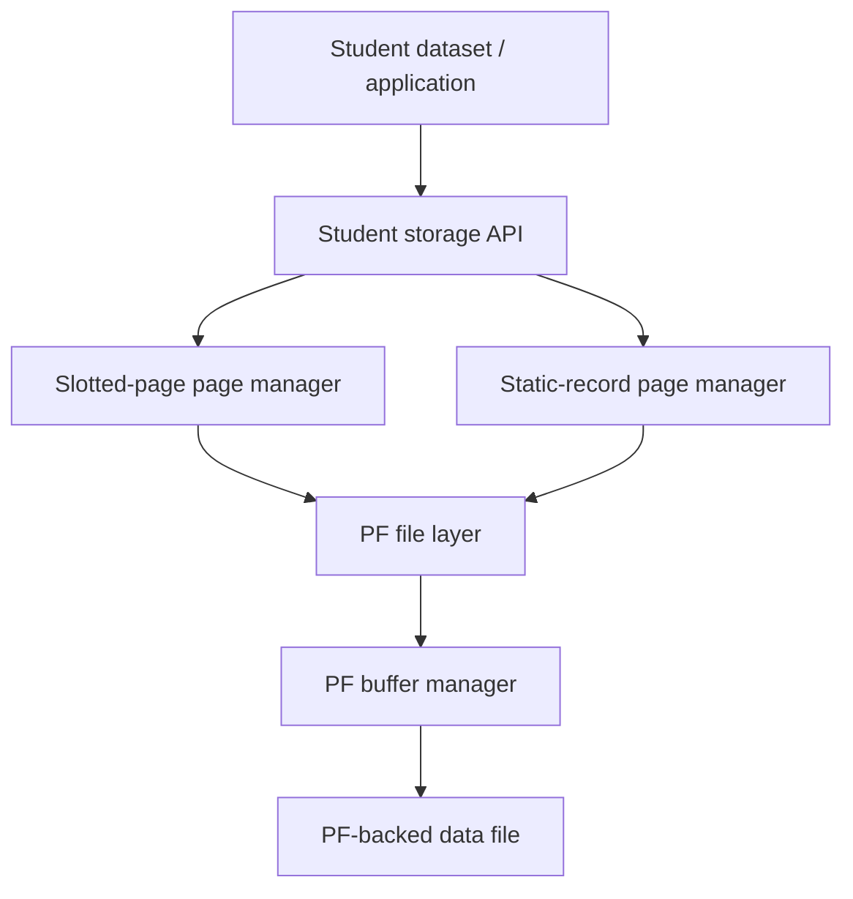
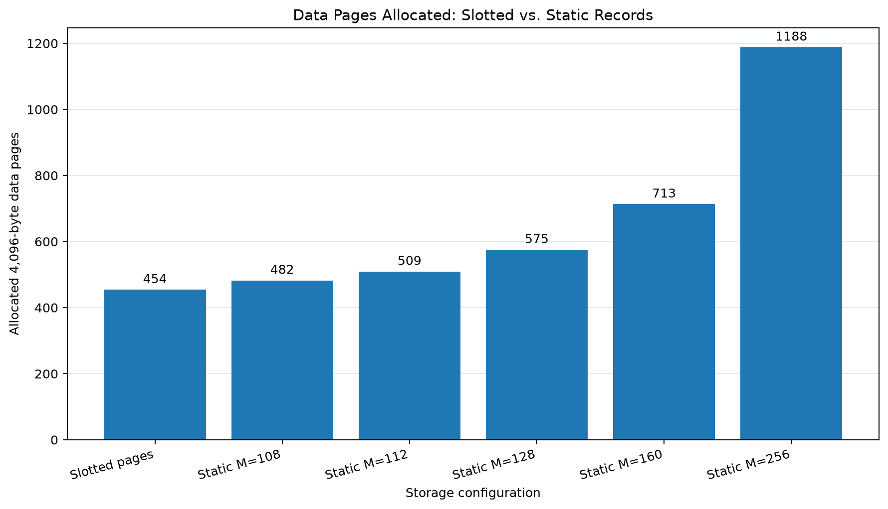
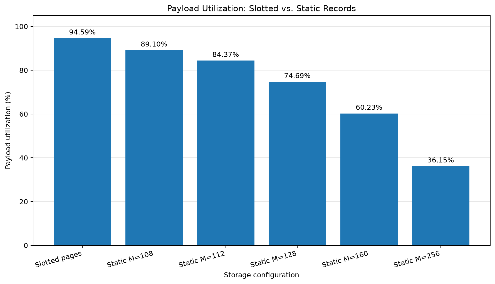

# ToyDB Storage Layer: Slotted Pages and Static Records

This directory contains the storage implementation developed for the ToyDB DBMS assignment. It includes two alternative page organizations for Student records:

For the full design rationale, algorithms, test evidence, and experiment analysis, see the [Technical Report](../Technical_Report.md) (also available as a PDF in the project root).

1. **Slotted-page storage** for variable-length records.
2. **Static-record storage** using fixed-size record slots.

Both implementations are integrated with the existing PF (Paged File) layer. The storage experiments use the supplied `data/student.txt` dataset and compare the number of PF data pages allocated and the fraction of those data-page bytes occupied by actual Student payload.

> **Current scope:** This README documents the slotted-page and static-record storage subsystem. Both formats are integrated with PF and are tested against the supplied Student dataset. The shared PF buffer manager and AM/B+ tree indexing work are also implemented and validated in the integrated project; see [`../pflayer/README.md`](../pflayer/README.md), [`../amlayer/README.md`](../amlayer/README.md), and the [master technical report](../Technical_Report.md) for those components.

---

## 1. Repository layout

The paths below are relative to the repository root:

```text
DBMS_Project/
├── data/
│   └── student.txt
└── toydb/
    ├── pflayer/
    │   ├── pf.c
    │   ├── buf.c
    │   ├── hash.c
    │   ├── pf.h
    │   ├── pftypes.h
    │   └── README.md           # PF buffer-manager design and experiments
    ├── amlayer/
    │   ├── README.md           # AM/B+ tree design and regression coverage
    │   └── AM_BENCHMARK_README.md
    ├── slottedpage/
    │   ├── slotted_page.c/.h
    │   ├── student_store.c/.h
    │   ├── static_page.c/.h
    │   ├── static_store.c/.h
    │   ├── rid.h
    │   ├── pf_api.h
    │   ├── test_*.c
    │   ├── Makefile
    │   └── README.md
    └── experiments/
        └── storage/
            ├── generate_storage_comparison.py
            ├── run_pf_experiments.py
            ├── run_am_experiments.py
            ├── requirements.txt
            ├── pf_layer/       # PF CSV, workbook, notes and graphs
            ├── am_layer/       # AM CSV, workbook, notes and graphs
            └── slotted_page/   # Storage CSV, test output and graphs
```

The Student dataset is located at `data/student.txt`, one directory above `toydb/`. The Makefile's default `STUDENT_FILE` is configured relative to `toydb/slottedpage`; override it when using a different checkout layout.

## 2. System architecture

The storage implementation is layered. Page-format code does not perform file I/O itself. The storage wrappers call the PF layer to allocate, retrieve, unfix, and persist pages.



The two storage formats are alternatives: a particular Student file is created using either the slotted-page store or the static-record store. They are not mixed in the same PF data file.

### Relevant modules

| Module | Responsibility |
|---|---|
| `slotted_page.c/.h` | 4,096-byte variable-length slotted-page operations |
| `student_store.c/.h` | PF-backed slotted Student file operations and sequential scan |
| `static_page.c/.h` | Fixed-slot static-record page operations |
| `static_store.c/.h` | PF-backed static-record file operations, scan, and storage statistics |
| `rid.h` | Shared page-number/slot-number RID encoding |
| `pf_api.h` | Typed declarations for the legacy PF API |
| `pflayer/` | PF files, buffer management, replacement policies, and I/O counters |

### PF buffer-manager configuration

The PF implementation exposes `PFbufSetCapacity()` and `PFbufSetPolicy()`. `PF_LRU` and `PF_MRU` select the replacement policy; the default policy is LRU and the default capacity is `PF_MAX_BUFS` (20 frames). The statistics interface exposes logical reads/writes, physical reads/writes, and buffer hits. PF capacity and read/write workload results are documented in [`../pflayer/README.md`](../pflayer/README.md); they are separate from the storage-space metric reported here.

### PF page-file overhead

The storage modules work with a 4,096-byte PF page buffer. In the tested PF file representation, each stored PF page also carries a 4-byte `nextfree` field, and the PF file begins with an 8-byte header. The estimated PF file size is:

$$
\text{PF file bytes} = (\text{data pages} \times 4096) + (\text{data pages} \times 4) + 8
$$

Payload utilization uses only the 4,096-byte data-page areas in its denominator. The PF wrapper and file-header bytes are reported separately as file-format overhead.

## 3. Slotted-page organization

### 3.1 Page layout

Each slotted page is exactly **4,096 bytes**.

The 12-byte header stores:

| Header field | Size | Purpose |
|---|---:|---|
| Magic value | 4 bytes | Identifies a page as a valid slotted page |
| `slot_count` | 2 bytes | Number of slot descriptors, including tombstones |
| `live_count` | 2 bytes | Number of currently live records |
| `free_start` | 2 bytes | First byte after the slot directory |
| `free_end` | 2 bytes | Start of the packed record region |
| **Total** | **12 bytes** | |

Each slot descriptor occupies 4 bytes:

| Slot field | Size | Purpose |
|---|---:|---|
| `offset` | 2 bytes | Byte offset of the record within the page |
| `length` | 2 bytes | Actual record length; zero denotes a deleted slot |

The slot directory grows from the beginning of the page. Record bytes are packed from the end of the page toward the beginning.

```text
Page byte 0                                                     Byte 4095
┌─────────────────────┬─────────────────────┬────────────────────────────┐
│ 12-byte page header │ 4-byte slot entries │ Packed variable-length     │
│                     │ grows forward  ---> │ records  <---              │
└─────────────────────┴─────────────────────┴────────────────────────────┘
                      ^ free_start          ^ free_end
                         contiguous free region
```

The directory and record area grow toward one another. `free_start` and `free_end` delimit the contiguous free region between them.

### 3.2 Insertion

`SP_InsertRecord()` performs the following operations:

1. Validate the page header and slot/record bounds.
2. Search for a deleted slot descriptor. If one exists, reuse its slot number.
3. Otherwise, reserve space for a new 4-byte descriptor.
4. Check whether the record bytes and any new descriptor fit in the contiguous free region.
5. If fragmentation prevents insertion but compaction would make enough room, compact the page and retry.
6. Copy the record bytes into the page from the end toward the beginning.
7. Update the selected slot descriptor and page metadata.

Reusing a tombstone avoids growing the slot directory. When a new slot is needed, the free-space requirement is the record length plus one 4-byte slot descriptor. When reusing an existing slot, only the record length needs to be added to the packed record region.

### 3.3 Deletion, tombstones, and compaction

`SP_DeleteRecord(page, slot)` marks a slot as deleted by setting:

```text
offset = 0
length = 0
```

It decrements `live_count`, but does not immediately move or reclaim the deleted record's former byte range. `slot_count` is retained so the slot numbers of surviving records remain stable.

`SP_CompactPage()` packs all live record bytes together, updates their offsets, and preserves their slot numbers and the slot-directory length. Deleted slots remain tombstones and can be reused by later insertions.

The insertion path can compact and retry automatically when fragmented free space is the only reason the record does not fit. `SP_GetFreeSpace()` reports contiguous free bytes between the directory and record region; it does not count unreclaimed holes as immediately available space.

### 3.4 Page validation

The page routines validate the magic value, header bounds, slot-directory bounds, live/slot counts, record offsets and lengths, and overlapping live-record regions. Invalid inputs, malformed pages, invalid/deleted slots, insufficient output buffers, and full-page conditions are reported through the module's status codes.

## 4. PF-backed slotted Student storage

`student_store.c/.h` provides file-level operations on top of the page routines:

- Create, destroy, open, and close a PF-backed Student file.
- Append a variable-length Student record.
- Retrieve or delete a record by RID.
- Compact a selected PF data page.
- Scan live records sequentially across PF pages.

`PF_Init()` must be called once before using the store API in a process.

### 4.1 Insert and persistence path

For an insertion, the store fixes the current PF page and attempts `SP_InsertRecord()`. If the record fits, the page is unfixed as dirty so PF knows it must be written. If it does not fit, the page is unfixed without modification, a new PF page is allocated and initialized with `SP_InitPage()`, and the insertion is retried there.

When a store is reopened, it traverses the PF pages and identifies the last valid slotted page. This allows subsequent appends to continue from the last page after close/reopen.

### 4.2 RID representation

The shared RID helper packs a PF page number and zero-based slot number into an integer:

```c
rid = (pageNum << 10) | (slotNum + 1);
```

The low 10 bits store `slotNum + 1`; zero is reserved as an invalid slot code. Decoding reverses this operation:

```c
pageNum = rid >> 10;
slotNum = (rid & 1023) - 1;
```

This convention is shared with the AM layer's integer RID interface. A RID identifies a physical page/slot location; it is not a Student roll number.

### 4.3 Sequential scan

`SPStore_Scan()` visits PF pages in page order and slots in slot order. It:

1. Gets the first PF page.
2. Reads the page's slot count.
3. Retrieves each live slot.
4. Skips tombstones.
5. Encodes the page/slot pair as an RID.
6. Invokes the caller's callback.
7. Unfixes the page without marking it dirty before moving to the next page.

A callback can continue, stop successfully, or report an error. The record buffer passed to the callback is only valid for the duration of that callback; callers must copy it if they need to retain it.

## 5. Static-record organization

Static-record storage uses fixed-size slots. The maximum record length `M` is selected when the file is created/tested.

### 5.1 Page and slot format

Each static page is 4,096 bytes and has an 8-byte header containing:

- A page-format magic value.
- The configured maximum record length `M`.
- The record count on the page.

Each record slot contains:

```text
┌──────────────────────────┬───────────────────────────────────────────┐
│ 2-byte actual-length     │ M-byte reserved record area               │
└──────────────────────────┴───────────────────────────────────────────┘
```

The actual length tells retrieval how many bytes of the reserved area belong to the record. The remaining reserved bytes are padding.

The maximum number of records that fit on one page is:

$$
C(M) = \left\lfloor \frac{4096 - 8}{M + 2} \right\rfloor
$$

where 8 is the page header size and 2 is the per-record length field.

| Maximum record length `M` | Slot size `M + 2` | Maximum slots per page |
|---:|---:|---:|
| 108 | 110 bytes | 37 |
| 112 | 114 bytes | 35 |
| 128 | 130 bytes | 31 |
| 160 | 162 bytes | 25 |
| 256 | 258 bytes | 15 |

`static_page.c/.h` implements page initialization, insertion, retrieval, and page metadata. `static_store.c/.h` provides PF-backed file creation/open/close, insertion, RID retrieval, sequential scanning, and storage-statistics collection. The static store reuses the shared RID convention.

## 6. Dataset and experimental methodology

The storage experiments use the supplied `data/student.txt` file.

| Dataset property | Value |
|---|---:|
| Student records (header excluded) | 17,813 |
| Actual record payload bytes (line endings excluded) | 1,759,011 bytes |
| PF data-page size | 4,096 bytes |
| Static maximum record lengths tested | 108, 112, 128, 160, 256 bytes |

The first descriptive line is skipped. CR/LF line endings are removed before each record is stored. The Python experiment runner independently reads the dataset to validate the record count and payload byte count.

### 6.1 Measurement definitions

**Allocated data-page bytes**

$$
\text{Allocated bytes} = \text{PF data pages allocated} \times 4096
$$

**Payload utilization**

$$
\text{Payload utilization} =
\frac{\text{Actual Student payload bytes}}
{\text{Allocated data-page bytes}} \times 100
$$

Payload utilization counts only Student record bytes in the numerator. Page headers, slot descriptors, record-length fields, and reserved padding are overhead—not payload.

**Slotted-page occupied bytes**

$$
\text{Occupied bytes}_{slotted}
= \text{Payload} + 12(\text{pages}) + 4(\text{records})
$$

**Static-record occupied bytes**

$$
\text{Occupied bytes}_{static}
= M(\text{records}) + 2(\text{records}) + 8(\text{pages})
$$

**Record padding in static storage**

$$
\text{Padding} = M(\text{records}) - \text{Actual payload bytes}
$$

**Unused page bytes**

$$
\text{Unused bytes} = \text{Allocated data-page bytes} - \text{Occupied page bytes}
$$

Record padding is inside the reserved slots and is therefore counted as occupied space. It is not the same as unused page bytes, which are the remaining bytes outside the occupied page structures.

### 6.2 Measurement provenance

The unified script runs the C tests and extracts the measurements from their output:

- The slotted-page PF page count comes from `test_student_pf` by traversing the actual PF file. The in-memory `test_student_dataset` page count is retained as a cross-check; the script requires the values to match.
- Each static page count and byte-accounting value comes from the corresponding PF-backed `test_static_pf` output block.
- The script reads `student.txt` to derive the record count and payload size, and validates those values against the expected supplied dataset.
- The page counts used in the graphs are not hardcoded in the Python script.

## 7. Final storage results

The following results were generated by the unified experiment runner after the PF-backed slotted-page page-count check was added.

| Configuration | Page capacity / observed average | PF pages | Allocated data-page bytes | Payload utilization |
|---|---:|---:|---:|---:|
| Slotted pages | 39.24 records/page (average) | **454** | 1,859,584 | **94.59%** |
| Static `M=108` | 37 slots/page (capacity) | 482 | 1,974,272 | 89.10% |
| Static `M=112` | 35 slots/page (capacity) | 509 | 2,084,864 | 84.37% |
| Static `M=128` | 31 slots/page (capacity) | 575 | 2,355,200 | 74.69% |
| Static `M=160` | 25 slots/page (capacity) | 713 | 2,920,448 | 60.23% |
| Static `M=256` | 15 slots/page (capacity) | 1,188 | 4,866,048 | 36.15% |

### 7.1 Detailed space accounting

**Record-area accounting**

| Format | Payload bytes | Reserved record bytes | Record padding | Length metadata |
|---|---:|---:|---:|---:|
| Slotted | 1,759,011 | 1,759,011 | 0 | 0 |
| Static 108 | 1,759,011 | 1,923,804 | 164,793 | 35,626 |
| Static 112 | 1,759,011 | 1,995,056 | 236,045 | 35,626 |
| Static 128 | 1,759,011 | 2,280,064 | 521,053 | 35,626 |
| Static 160 | 1,759,011 | 2,850,080 | 1,091,069 | 35,626 |
| Static 256 | 1,759,011 | 4,560,128 | 2,801,117 | 35,626 |

**Page-structure accounting**

| Format | Page headers | Slot directory | Occupied page bytes | Unused page bytes |
|---|---:|---:|---:|---:|
| Slotted | 5,448 | 71,252 | 1,835,711 | 23,873 |
| Static 108 | 3,856 | 0 | 1,963,286 | 10,986 |
| Static 112 | 4,072 | 0 | 2,034,754 | 50,110 |
| Static 128 | 4,600 | 0 | 2,320,290 | 34,910 |
| Static 160 | 5,704 | 0 | 2,891,410 | 29,038 |
| Static 256 | 9,504 | 0 | 4,605,258 | 260,790 |

For slotted pages, `reserved record bytes` equals the actual payload because each record stores only its actual length. The slot directory stores each record's offset and length separately.

### 7.2 Generated figures

**PF data pages allocated**



**Payload utilization**



The machine-readable measurements are in [`storage_comparison.csv`](../experiments/storage/slotted_page/storage_comparison.csv). The exact test output is in [`storage_test_results.txt`](../experiments/storage/slotted_page/storage_test_results.txt), and the generated summary is in [`storage_comparison_notes.md`](../experiments/storage/slotted_page/storage_comparison_notes.md).

The estimated PF file sizes, including the 4-byte per-page wrapper field and 8-byte file header, are:

| Configuration | Estimated PF file size |
|---|---:|
| Slotted pages | 1,861,408 bytes |
| Static `M=108` | 1,976,208 bytes |
| Static `M=112` | 2,086,908 bytes |
| Static `M=128` | 2,357,508 bytes |
| Static `M=160` | 2,923,308 bytes |
| Static `M=256` | 4,870,808 bytes |

The static-file estimates agree with earlier retained-file `stat` checks. The primary comparison metric remains payload bytes divided by allocated 4,096-byte data-page bytes.

## 8. Interpretation

1. **Slotted pages use the fewest PF data pages in this experiment.** They use 454 pages, compared with 482 pages for the most space-efficient static configuration (`M=108`). This is 28 fewer pages, or approximately **5.81% fewer pages** relative to the `M=108` static result.

2. **Slotted pages have the highest payload utilization.** Their 94.59% payload utilization is approximately **5.49 percentage points** higher than static `M=108` at 89.10%.

3. **Static padding grows with `M`.** Every record reserves the configured maximum `M` bytes even when its actual length is shorter. The measured padding rises from 164,793 bytes at `M=108` to 2,801,117 bytes at `M=256`.

4. **The slot directory is the slotted-page trade-off.** Slotted pages require a 4-byte descriptor per slot and a 12-byte page header. Those bytes are overhead, but the record data area does not reserve `M` bytes for every record.

5. **The best static configuration is the smallest tested `M` that accommodates the dataset.** Increasing `M` reduces slot capacity per page and increases reserved space per record. It therefore increases the number of pages and reduces payload utilization for this dataset.

These conclusions concern space allocation for the tested dataset. They do not establish that one organization is faster for every insertion, lookup, deletion, or scan workload.

## 9. Reproducing the experiments

### Prerequisites

- Linux environment with a C compiler and `make`.
- Python 3.
- The supplied `data/student.txt` file at the repository's `data/` path, unless another path is provided.
- Matplotlib and OpenPyXL for the consolidated experiment tooling.

From the repository root, create the shared experiment environment:

```bash
python3 -m venv .venv
source .venv/bin/activate
python -m pip install --upgrade pip
python -m pip install -r toydb/experiments/storage/requirements.txt
```

### Run the complete storage comparison

From the repository root:

```bash
python3 toydb/experiments/storage/generate_storage_comparison.py
```

The script:

1. Locates and validates the Student dataset.
2. Runs `make clean` in `toydb/slottedpage`.
3. Runs the in-memory slotted Student test.
4. Runs the PF-backed slotted Student insert/reopen/RID test.
5. Runs the PF-backed sequential-scan dataset test.
6. Runs all static page-level tests.
7. Runs PF-backed static tests for `M=108,112,128,160,256`.
8. Saves the captured test output.
9. Extracts actual page counts and byte measurements.
10. Verifies counts and storage-accounting equations.
11. Regenerates the CSV, graphs, and Markdown notes.

To use another dataset path:

```bash
python3 toydb/experiments/storage/generate_storage_comparison.py \
    --student-file /absolute/path/to/student.txt
```

### Run the storage Makefile tests directly

From `toydb/slottedpage/`:

```bash
make clean
make test STUDENT_FILE=../../data/student.txt
```

Useful focused targets include:

```bash
make test-basic
make test-student STUDENT_FILE=../../data/student.txt
make test-phase2
make test-pf
make test-pf-phase3
make test-student-pf STUDENT_FILE=../../data/student.txt
make test-scan
make test-scan-dataset STUDENT_FILE=../../data/student.txt
make test-static-page
make test-static-pf-all STUDENT_FILE=../../data/student.txt
```

To retain a static PF file for manual inspection:

```bash
./test_static_pf ../../data/student.txt 128 --keep
ls -lh static_students_M128.pf
```

Without `--keep`, the PF-backed static test removes its temporary database after verification.

### Generated output locations

The unified storage experiment writes its result set to:

```text
toydb/experiments/storage/slotted_page/
```

Do not edit the generated CSV or graphs manually. Rerun the script after changing the dataset, implementation, or experiment code so that all outputs remain consistent.

## 10. Test coverage and verified results

The completed storage implementation has been exercised at page level, through PF integration, and against the full Student dataset.

| Test area | Verified behaviour / result |
|---|---|
| Phase 1 slotted pages | Initialization, variable-length insert/retrieve, invalid inputs, full-page handling |
| Phase 2 slotted pages | 7/7 tests for deletion, tombstones, reuse, compaction, stable slots, page-full boundaries, and corruption checks |
| PF integration | Multi-page insertion, RID retrieval, close/reopen persistence, append recovery |
| PF-backed mutation | Deletion and compaction persist across reopen; deleted slot/RID reuse |
| Slotted Student dataset | 17,813 records verified by RID after close/reopen |
| Synthetic sequential scan | 250 inserted, 4 deleted, 246 live records scanned; early-stop callback and reopen tested |
| Full Student sequential scan | 17,813 inserted and 17,813 scanned; zero missing/extra records |
| Static page tests | All five `M` values pass page initialization, capacity, insertion, and retrieval checks |
| Static PF dataset tests | For every `M`, 17,813 inserted, scanned after reopen, and RID retrievals verified |

The storage comparison run after integration with the shared PF changes completed successfully. The PF-backed slotted page count and in-memory page count were both 454.

## 11. Integrated project status and scope boundaries

This README focuses on page storage. In the integrated project:

- The PF layer provides configurable buffer capacity, LRU/MRU replacement, dirty-page writeback, statistics, and automated capacity/read-write experiments. See [`../pflayer/README.md`](../pflayer/README.md).
- The AM layer supports one-shot, incremental, and sorted bulk index construction, duplicate-key grouping, root capacity validation, dynamic leftmost-leaf discovery, and index benchmarks. See [`../amlayer/README.md`](../amlayer/README.md).
- The master report combines all three subsystems and records the integrated test results: [`../Technical_Report.md`](../Technical_Report.md).

The AM bulk loader currently supports one internal root above the leaf level; multi-level internal-tree construction is not implemented. The additional G5 cleanup and dedicated G6 RID-to-Student payload cross-check were deferred. These scope limits do not change the storage results documented in this README.

---

## 12. Summary

The implemented slotted-page and static-record stores both persist Student records through the PF layer and support RID-based retrieval and sequential scanning. On the supplied 17,813-record Student dataset, slotted pages use 454 PF data pages and achieve 94.59% payload utilization. The best tested static configuration, `M=108`, uses 482 pages and achieves 89.10%; larger static maximum lengths increase padding and page consumption.

The unified experiment runner makes the comparison reproducible by running the C tests, extracting their measured outputs, validating the accounting, and regenerating the results table and graphs.


## 13. Relationship to the other modules

The same integer RID representation is used by slotted/static Student storage and the AM layer. The storage layer produces a page/slot RID; the AM leaf stores that RID under the roll-number key. This README describes how the physical record is stored, while the AM README describes how the key-to-RID index is built and searched.

For the complete PF, storage, and AM architecture, experiment results, and root-level build/test workflow, see [`../Technical_Report.md`](../Technical_Report.md).
